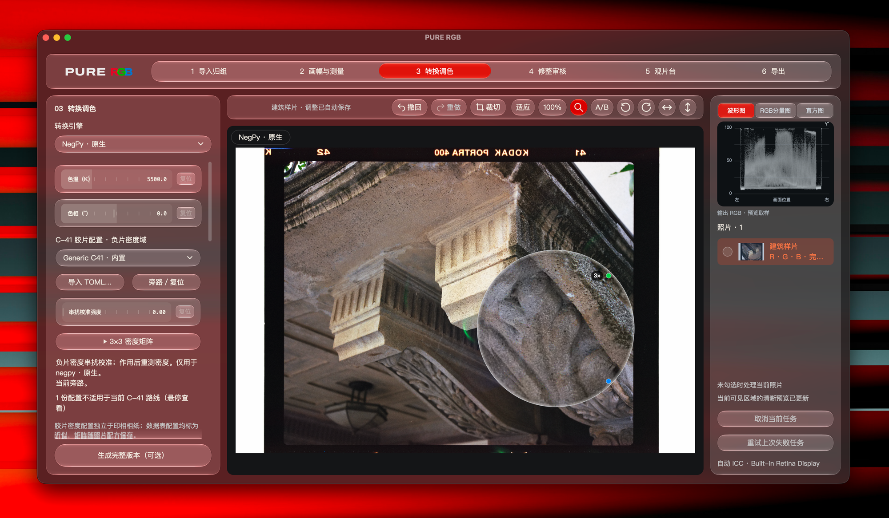
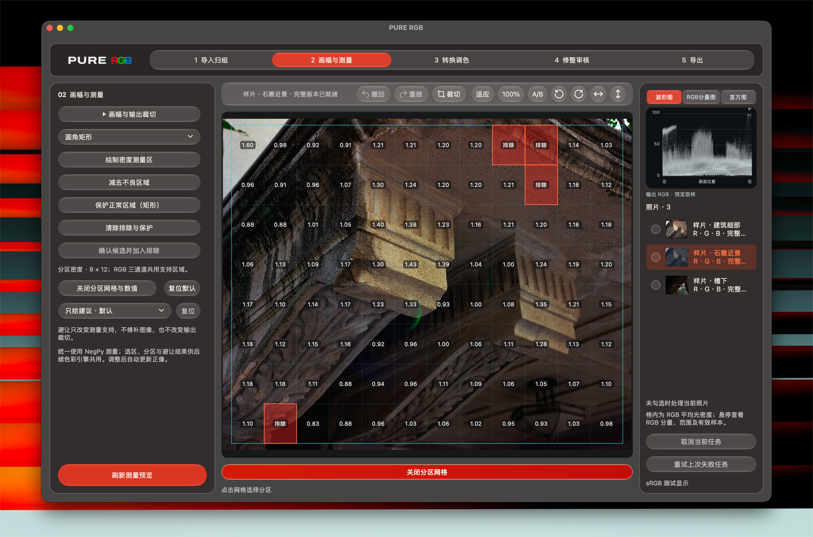
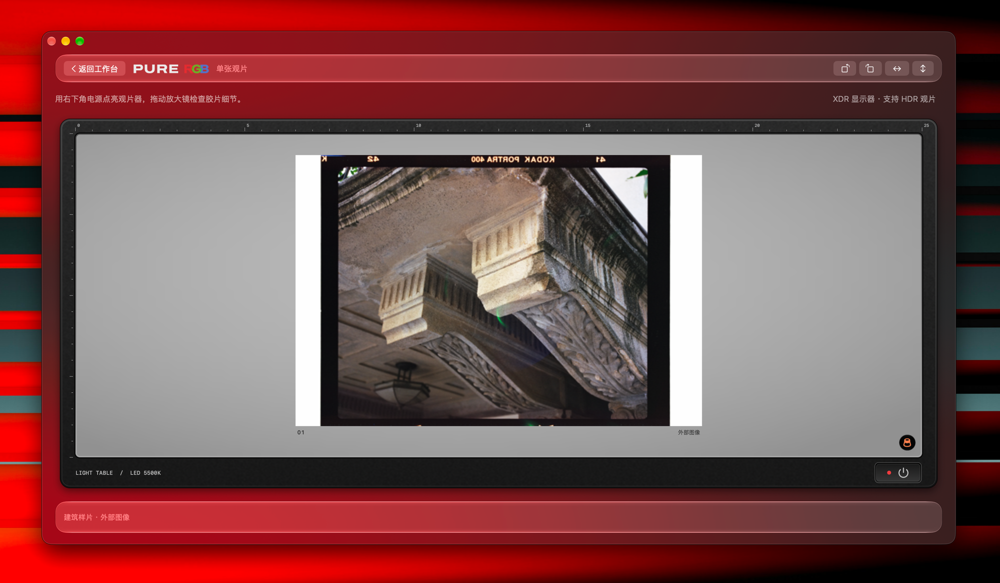

# PURE RGB

PURE RGB 基于 [NegPy](https://github.com/marcinz606/NegPy) 开发，感谢 marcinz606 与上游贡献者。

**PURE RGB 0.2.4** 是 StudioPURE 为 Apple 芯片 Mac 开发的胶片数字化工作台。它把同一帧底片在红、绿、蓝光下拍摄的三张 RAW 合成为彩色正像，从密度测量、转换调色、除尘审核到选片导出，都在同一套工作流内完成。

[下载 0.2.4](https://github.com/easonzhangbin/PURERGB/releases/tag/v0.2.4) · [中文使用指南](docs/OPERATING_MANUAL.zh-CN.md) · [本版改进](docs/releases/0.2.4.md) · [捐赠 StudioPURE 项目](SUPPORT.md)



## RGB 分色翻拍图解 / Illustrated trichrome guide

九张图展示同一格负片的三路 RAW、片基配平、原始 RAW 曝光余量和正像转换。用实拍说明**橙框决定调哪一路灯，蓝框决定三路要不要一起改快门**。图解附有柯达原厂手册和 DIASTOR 研究的原文链接。

Follow one negative from three separate RAW exposures to a finished positive. The nine illustrated cards explain how the orange box guides individual lamp changes and the blue box guides a shared exposure change.

[中文九图指南](docs/RGB_TRICHROME_GUIDE.zh-CN.md) · [English illustrated guide](docs/RGB_TRICHROME_GUIDE.en.md)

## 工作台与观片台

- **六步工作流。** 顶部依次为「导入归组」「画幅与测量」「转换调色」「修整审核」「观片台」「导出」。半透明磨砂玻璃面板透出底色，明亮的橙红色标示当前步骤和主要操作。照片、调节参数和输出示波器可同时查看。
- **检查照片细节。** 点「100%」旁的放大镜，再点照片定位。镜片默认 3×、直径 288 点，拖动可沿画面检查颗粒与锐度。蓝点调整镜片大小，绿点或滚轮调整倍率，最高 8×。
- **精调参数。** 曝光、色温和高光强度等工作台参数采用 Scrubber 滑块。点选刻度、沿轨道拖动或用方向键逐格调整，当前值随操作显示。
- **单张观片与整卷挑片。** 第五步打开独立原生观片台，可以点亮灯板、拖动放大镜，也能挑选整卷并将结果带回导出列表。支持直接打开已有的 TIFF、JPEG、PNG 或 HEIF。
- **XDR 与全屏。** 从 Mac 内建 XDR 屏打开观片台时默认全屏，按 Esc 回到窗口。外接 SDR 屏以窗口打开。跨屏移动会更新 HDR 提示。完整 HDR 观片体验需要 XDR 屏、合适的显示模式及 macOS 26 或更新版本。

| 分区密度测量（可选实验） | 独立观片台 |
| --- | --- |
| [](docs/images/zonal-density.png) | [](docs/images/light-table.png) |
| 切换到实验方式后，可逐格查看密度，点击排除或恢复该区域。 | 将转换后的正像放在灯板上，检查细节或挑选整卷。 |

## 0.2.4 的主要改进

- NegPy 原生彩色模式的「高光找回」从负片密度保留亮部纹理与过渡，支持 0–100% 强度。
- 「印相曝光（EV）」根据负片密度计算亮度，保留原有颜色比例。降低曝光可展开 RAW 已记录的亮部层次。
- 滑杆拖动先更新轻量预览，松手后再刷新细节。切换色彩引擎、裁切和 100% 查看可复用已准备的源与测量。
- 初始密度默认测量有效画幅中心约 80% 的面积。灯光配平可建议片间空隙，并由用户调整和确认。

[完整发行说明](docs/releases/0.2.4.md)

## 0.2.3 的主要改进

- 在「导入归组」开放可选的 RGB 灯光配平，分别检查片基配平和保留画幅内的 RAW 曝光。
- 支持手动载入平场 RAW、选用已保存的平场，以及保存灯具设置和按参考计算调节量。
- 随应用提供配平指南和柯达资料的中英对照解读，并保留原文链接。[配平中英文说明](docs/RGB_LIGHT_BALANCE_BILINGUAL.md)

## 0.2.2 的主要改进

- 新增图片库，以及三色翻拍、片基与平场的图文介绍。
- 加入自动镜头色差矫正，支持从本机匹配 Adobe LCP。兼容平场可按画幅匹配同型号相机的不同分辨率。
- 加快 NegPy 原生、Nikon CMS 和 FlexColor 预览及高光找回。单击工具栏「裁切」可直接进入画布裁切。
- 暂时撤下 RGB 灯光配平入口和演示，待调灯与复测流程完善。

## 0.2.1 工作流程改进

- **自动批量导入。** 选择素材文件夹或多选 RAW 后自动归组、排队处理，每组显示缩略图，无需逐张点击「核对并导入」。彩色批量导入无法可靠识别片框时，先用完整源的中心区域测量，保留整张输出，之后可手动调整范围。
- **完整 NegPy 测量为默认。** 分区测量保留为可选实验方案。白点、黑点及亮度／颜色截断使用原生参数规则，实际自动印相密度和 ISO-R 反差显示在更新后的画面左上角。测量高级参数移到区域操作下方，默认展开。
- **整卷沿用平场。** 兼容的照片及后续导入组共用已选平场和强度，无需逐张重复应用；更换拍摄条件后应重新选择匹配参考。
- **除尘数据随照片保留。** 已确认修复作为隐藏数据保存，后续调色、常规裁切、拉直、90° 旋转和翻转后自动映射到新画幅，用于预览与完整导出。原审核记录不改写；画笔半径也会记住上次设置。
- **单选、多选与全选。** 导出按所选照片生成完整 RGB16 TIFF；在选中的照片上右键卸载，可一次从列表移除全部所选。原始 RAW、调整、除尘记录和保存版本保留，重新导入相同素材可恢复。
- **保留可靠的裁切操作。** 移除「保留片基文字」「仅有效图像」两个自动裁切入口，保留手动裁切、拉直、旋转及已有裁切参数。
- **提示与稳定性。** 提示浮层、错误、确认、更新及除尘提示统一居中，修正长中文换行；修复批量照片列表崩溃及临时 TIFF 元数据变化引起的除尘误报。[完整发行说明](docs/releases/0.2.1.md)

## 色彩引擎与输入

| 引擎 | 实现范围 |
| --- | --- |
| NegPy · 原生 | 使用 NegPy 的密度分析、反相和数码印相处理。 |
| Nikon CMS · 仅 CMS | 将中性 RGB16 正像送入 CML4 研究链，可选固定曲线。需要本机自备且有权使用的匹配研究资源。 |
| FlexColor · 演算 | 默认以共享密度窗口与公开重建的曲线算法做中性演算。经过验证的本机资源配方可启用原曲线与六色校正。 |

三种引擎的彩色工作流使用同一底片的三次分光拍摄，输入可选择「拜耳 RGB · 三张 RAW」或「单色 RGB · 三张 RAW」，并核对 R、G、B 通道顺序。单色流程直接读取传感器样本，使用文件记录的黑白位归一化。单张彩色翻拍的 Bayer RAW 使用不同的采集域，本版没有对应转换入口。单张黑白负片可走 NegPy 原生流程。Nikon 与 FlexColor 路线用于比较逆向研究所得的处理阶段，色彩输出以相机采集与当前的工作域假设为基础。

## 安装与启动

**Apple 芯片 Mac 下载，要求 macOS 14 或更新版本**。打开 PKG 后按 macOS 安装助手指引安装到「应用程序」。安装包包含运行环境。PKG 没有 Developer ID Installer 签名，应用使用本机临时签名，尚未通过 Apple 公证。若首次打开时 macOS 提示无法验证开发者，先核对发布页上的 SHA-256。如确定来自本项目，可在「系统设置 → 隐私与安全性」中选择「仍要打开」，按当时的系统提示确认。 [下载 PKG 安装助手](https://github.com/easonzhangbin/PURERGB/releases/download/v0.2.4/PURE-RGB-0.2.4-macos-arm64.pkg) · [Apple 官方说明](https://support.apple.com/zh-cn/102445)

### 从源码运行

需要 Git、[uv](https://docs.astral.sh/uv/getting-started/installation/)、稳定版 [Rust 工具链](https://rust-lang.org/tools/install/) 和 Apple 命令行开发者工具。可用 `xcode-select --install` 安装 Apple 工具。准备好这些工具后，再执行以下命令。安装脚本使用 Python 3.13 和固定依赖，首次编译可能需要数分钟。

```bash
git clone --branch v0.2.4 https://github.com/easonzhangbin/PURERGB.git
cd PURERGB
python3 bootstrap.py
./PURE\ RGB.command
```

要在 Finder 里启动，可在本机完成上述安装后构建应用。该应用仍使用构建时的源码目录和虚拟环境。

```bash
vendor/negpy/.venv/bin/python tools/build_local_test_app.py "$HOME/Applications/PURE RGB 0.2.4.app"
```

应用在启动后及持续运行期间每 24 小时查询 GitHub 正式发布通道。点击「查看更新」阅读说明并下载安装，也可以在 macOS 的 PURE RGB 菜单中主动检查。

### 可选 Nikon 资源

仅在拥有可使用的匹配资源时，把 CML4 资源、ICC、固定曲线和验证文件放入本机的 `vendor/cool-colors/assets/nikon_cml4/`。安装脚本只取得参考源码。运行以下探针可核对所需名称和哈希。

```bash
vendor/negpy/.venv/bin/python -m pure_rgb.nikon_resource_probe
```

缺少资源时可使用 NegPy 和 FlexColor 路线。Nikon 的预扫描原始特性数据、扫描仪厂商配置与实验捕获数据保留在其各自的权利范围内。

## 后续计划

本版的整卷挑选使用当前项目的照片列表。

## 捐赠 StudioPURE 项目

感谢捐助者 **nothing老庄、J3RRYK33PF1T、熊小默、基岩、一笑而过**。欢迎使用支付宝扫描项目收款码，自愿支持后续开发。


应用内也可在「PURE RGB → 捐赠 StudioPURE 项目」查看同一张二维码。[捐赠说明](SUPPORT.md)

## 许可与致谢

**上游项目：[marcinz606/NegPy](https://github.com/marcinz606/NegPy)。** PURE RGB 是基于 NegPy 的派生开发版本，感谢原作者 marcinz606 及 NegPy 贡献者；保留原项目署名与 GPL-3.0 许可。当前采用的 NegPy 基线为 0.68.0（[`d8123a9`](https://github.com/marcinz606/NegPy/tree/d8123a9b2a18fdaab5941347a91e402fa936d3dc)）。

软件源码采用 [GPL-3.0](LICENSE)。项目由 NegPy 的开源工作发展而来，并参考 cool-colors、flexcolor-tool 与 nkscan。品牌图标和字标保留各自权利。详见 [第三方来源与许可](THIRD_PARTY_NOTICES.md)。

宣传截图使用 Milad Fakurian 的桌面壁纸。 [Unsplash 原作](https://unsplash.com/photos/red-and-black-horizontal-striped-abstract-background-WlFOb5WgWvY) · [许可](https://unsplash.com/license)
