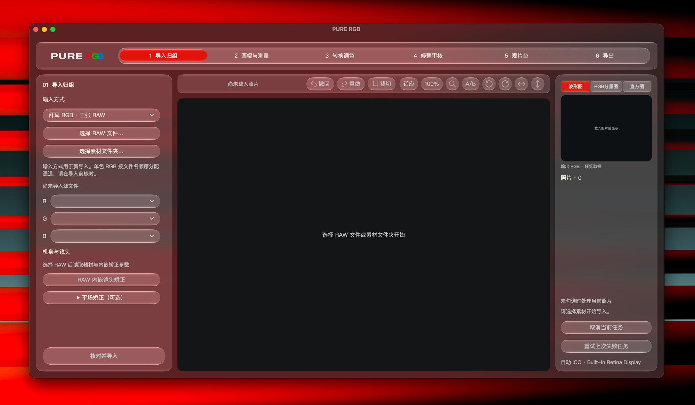

# PURE RGB

**上游项目：[marcinz606/NegPy](https://github.com/marcinz606/NegPy)。** PURE RGB 是基于 NegPy 的派生开发版本，感谢原作者 marcinz606 及 NegPy 贡献者；保留原项目署名与 GPL-3.0 许可。当前采用的 NegPy 基线为 0.68.0（[`d8123a9`](https://github.com/marcinz606/NegPy/tree/d8123a9b2a18fdaab5941347a91e402fa936d3dc)）。

**PURE RGB 0.1.1** 是基于 [NegPy 0.68](https://github.com/marcinz606/NegPy/tree/d8123a9b2a18fdaab5941347a91e402fa936d3dc) 的 macOS 胶片数字化工作台。面向同一帧分别以红、绿、蓝光拍摄的 RAW，将三路信号配准合成，在同一测量结果上比较色彩呈现，然后输出带 ICC 的 RGB16 TIFF。

[0.1.1 新特性与修复](docs/releases/0.1.1.md) · [中文操作手册](docs/OPERATING_MANUAL.zh-CN.md) · [GitHub Releases](https://github.com/easonzhangbin/PURERGB/releases) · [捐赠支持 StudioPURE](https://github.com/easonzhangbin/PURENeg/blob/main/SUPPORT.md)



界面截图使用实拍建筑底片。桌面壁纸由 Milad Fakurian 创作。 [Unsplash 原作](https://unsplash.com/photos/red-and-black-horizontal-striped-abstract-background-WlFOb5WgWvY)

## 0.1.1 更新

本次正式包为 **0.1.1 build 7**，替换此前撤回的安装包。新增拜耳 RGB／单色 RGB 分流、导入后自动选取有效画面中心约 80% 面积测量密度、启动时恢复或新建任务；修复高光绘制负像、裁切与旋转坐标，以及局部高光矩形痕迹。持久解码缓存、空闲预热、测量复用和按可用内存调度导出用于减少重复计算。完整回归 5,287 项通过，实际单色 DNG 完整流程及安装包签名检查通过。

正式更新通道使用 GitHub Releases latest。0.1.1 启动后和每隔 24 小时后台检查，设置中可手动检查；发现新版后提示下载，安装由用户完成。已装过旧 0.1.1 的用户需手动下载本次 build 7 替换。详细变化、实测条件和限制见 [发行说明](docs/releases/0.1.1.md)。

## 工作台设计

- 五步流程贯穿**导入归组、画幅与测量、转换调色、修整审核、导出**。中央保留正像，左右侧栏分别承载参数与照片、波形图、RGB 分量图和直方图。应用继承 macOS 的原生材质设置。
- 窗口背景结合 SwiftUI 极薄材质与 AppKit 的桌面背景效果，无法加载时回退到 AppKit 材质。
- **分区密度测量**在有效画面上叠加网格。点击单元可排除或恢复，单元的视觉状态会更新，密度测量按新的有效样本重新计算。输出裁切、拉直和方向随照片共用。
- **高光找回**支持独立参考区、局部作用区和可调整的羽化半径。关闭后重新启用时保留用户设置。
- **修整审核**由 PURE RGB 承载界面，按需调用独立安装的 [PURE Neg](https://github.com/easonzhangbin/PURENeg/releases/latest) 后端。修复确认后返回工作台，再从同一流程导出。

## 色彩引擎与输入

| 引擎 | 实现范围 |
| --- | --- |
| NegPy · 原生 | 使用 NegPy 的密度分析、反相和数码印相处理。 |
| Nikon CMS · 仅 CMS | 将中性 RGB16 正像送入 CML4 研究链，可选固定曲线。需要本机自备且有权使用的匹配研究资源。 |
| FlexColor · 演算 | 默认以共享密度窗口与公开重建的曲线算法做中性演算。经过验证的本机资源配方可启用原曲线与六色校正。 |

三种引擎的彩色工作流使用同一底片的三次分光拍摄，输入可选择「拜耳 RGB · 三张 RAW」或「单色 RGB · 三张 RAW」，并核对 R、G、B 通道顺序。单色流程直接读取传感器样本，使用文件记录的黑白位归一化。单张彩色翻拍的 Bayer RAW 使用不同的采集域，本版没有对应转换入口。单张黑白负片可走 NegPy 原生流程。Nikon 与 FlexColor 路线用于比较逆向研究所得的处理阶段，色彩输出以相机采集与当前的工作域假设为基础。

## 安装与启动

**Apple 芯片 Mac 下载，要求 macOS 14 或更新版本**。解压 ZIP 后把 `PURE RGB.app` 拖入「应用程序」。随包交付运行环境，可直接启动。此包为临时签名，尚未通过 Apple 公证。若 macOS 在首次打开时提示无法验证，请核对发布页的 SHA-256 与来源，再参照 Apple 的说明处理。 [下载应用](https://github.com/easonzhangbin/PURERGB/releases/download/v0.1.1/PURE-RGB-0.1.1-macos-arm64.zip) · [Apple 官方说明](https://support.apple.com/en-us/102445)

### 从源码运行

需要 Git、[uv](https://docs.astral.sh/uv/getting-started/installation/)、稳定版 [Rust 工具链](https://rust-lang.org/tools/install/) 和 Apple 命令行开发者工具。可用 `xcode-select --install` 安装 Apple 工具。准备好这些工具后，再执行以下命令。安装脚本使用 Python 3.13 和固定依赖，首次编译可能需要数分钟。

```bash
git clone --branch v0.1.1 https://github.com/easonzhangbin/PURERGB.git
cd PURERGB
python3 bootstrap.py
./PURE\ RGB.command
```

要在 Finder 里启动，可在本机完成上述安装后构建应用。该应用仍使用构建时的源码目录和虚拟环境。

```bash
vendor/negpy/.venv/bin/python tools/build_local_test_app.py "$HOME/Applications/PURE RGB 0.1.1.app"
```

应用在后台检查 GitHub 的最新正式发布，发现新版时显示发布页入口；也可在设置中手动检查。下载和安装由用户自行完成。捐赠入口打开 StudioPURE 已公开的支持页面。

### 可选 Nikon 资源

仅在拥有可使用的匹配资源时，把 CML4 资源、ICC、固定曲线和验证文件放入本机的 `vendor/cool-colors/assets/nikon_cml4/`。安装脚本只取得参考源码。运行以下探针可核对所需名称和哈希。

```bash
vendor/negpy/.venv/bin/python -m pure_rgb.nikon_resource_probe
```

缺少资源时可使用 NegPy 和 FlexColor 路线。Nikon 的预扫描原始特性数据、扫描仪厂商配置与实验捕获数据保留在其各自的权利范围内。

## 0.1.2 功能计划

| 功能 | 状态 |
| --- | --- |
| 目录管理 | 待开发 |
| 图片库管理 | 待开发 |
| PURE Neg 观片器 | 待引入 |

## 许可与致谢

软件源码采用 [GPL-3.0](LICENSE)。项目由 NegPy 的开源工作发展而来，并参考 cool-colors、flexcolor-tool 与 nkscan。品牌图标和字标保留各自权利。详见 [第三方来源与许可](THIRD_PARTY_NOTICES.md)。
