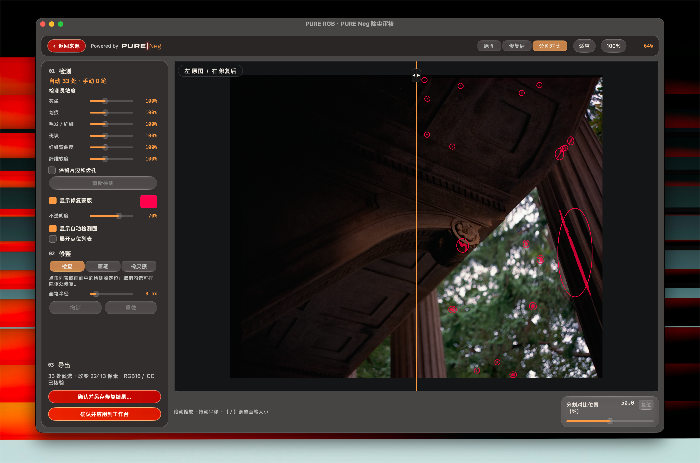

# PURE RGB 操作手册

**版本 0.1.1**

PURE RGB 是基于 NegPy 0.68.0 开发的胶片数字化工作台。它把同一帧底片的红、绿、蓝三次独立 RAW 采集合成为一张照片，共用一套密度测量与画幅设置，再分别交给 NegPy、Nikon CMS 或 FlexColor 路线转换。分区密度网格是本项目的核心设计，可以逐格查看统计并排除或恢复对应区域。另有独立的单张黑白负片流程。 [NegPy 上游](https://github.com/marcinz606/NegPy)

*PURE RGB 实际工作台，预览为实拍建筑胶片样片。*

## 导入前准备

macOS Apple Silicon 用户可从 GitHub 发行页下载应用包。源码运行时，在项目目录运行 `python3 bootstrap.py` 安装所需依赖，然后运行 `./PURE\ RGB.command` 打开工作台。依赖和可选研究资源的准备方式见 [项目 README](../README.md)。

| 素材 | 输入方式 | 可用路线 |
| --- | --- | --- |
| 同一帧底片，在 R、G、B 光源下分别拍摄的三张 RAW | 彩色负片 · RGB 三张 | NegPy · 原生、FlexColor · 演算（中性曲线）。配置本机资源后可用 Nikon CMS · 仅 CMS，以及 FlexColor 的本机资源配方。 |
| 一张黑白负片翻拍 RAW | 黑白负片 · 单张 RAW | NegPy · 原生黑白，支持分区测量 |
| 一张白光下翻拍的彩色负片 RAW 或一张彩色成片 | 当前版本未提供彩负转换入口 | 使用三色采集素材，或在支持这种输入的软件中转换 |

三色采集时固定底片、相机、焦距、对焦和构图，每次仅切换照明通道。保留相机 RAW，并记录每张文件对应的光源。导入入口接受 RW2 和符合导入条件的 DNG。相机单张彩色 RAW 可经去马赛克形成 RGB 图像，其色彩信息来自一次照明和相机滤色阵列。PURE RGB 的三色路线要求三次已知照明条件下的独立观测；单张 RGB 图像中的三个数值不足以重新取得这三次测量。

## 五步操作

### 1. 导入归组

选择输入方式，再用「选择 RAW 文件…」或「选择素材文件夹…」加入素材。彩色组请核对 R、G、B 下拉框中的文件，每个位置对应一张不同的 RAW。右侧照片列表中，当前查看照片与勾选的批量处理照片独立。

对具备可识别镜头信息的三色 RAW，可启用「RAW 内嵌镜头矫正」。需要补偿照明不均时，展开「平场矫正」，选择在同机位、镜头、光圈与对焦状态下移开底片拍摄的均匀白光参考，或选择已有的平场增益 NPZ。0% 旁路，100% 采用完整平场校正，200% 施加两倍曝光校正量。增益作用在合成源上，三条彩色路线共用。单张白光参考校正照明不均与空间色偏，逐 LED 标定和暗场测量需要其他采集数据。

点击「核对并导入」。首次导入会定位有效片框，完成后自动进入「画幅与测量」。NegPy 的自动定位无法确认边界时，程序会用当前源的透射与正像定位图复核四边。边界仍不明确时，请在显示的正像上拖出有效画面矩形，松开后自动继续导入。

### 2. 画幅与测量

在「绘制密度测量区」前选择矩形、圆角矩形、椭圆或手绘套索，新选区默认使用矩形。选区应覆盖具有代表性的有效画面，尽量避开片边、齿孔和已知的漏光或冲洗异常。完成绘制后会显示分区网格，默认 8 行 × 12 列，每格 2 × 2 个测量子块。

- **查看分区**。格内数字概览该区的 RGB 光密度。悬停可看三通道中位光密度、分位范围、有效像素和有效子块数。
- **排除或恢复**。点击网格中的一格，选择「排除该分区」或「恢复该分区」。格子的颜色显示排除状态，预览和测量数值会重新计算。仍在计算时显示「待更新」。常用的撤回和重做为 `⌘Z` 和 `⇧⌘Z`。
- **画出不规则坏区**。用「减去不良区域」指定局部排除。开启自动避让时，可用「保护正常区域（矩形）」保留容易被误判的正常画面。默认「只给建议」，可检查候选后用「确认候选并加入排除」纳入测量。
- **单独管理网格**。用「显示分区网格与数值」或「关闭分区网格」切换显示。「复位默认」恢复网格尺寸与子块数，保留当前测量范围及排除设置。「清除排除与保护」用于清除这些设置。

*PURE RGB 实际分区密度界面，预览为实拍建筑胶片样片。*

输出画幅在「裁切、拉直与旋转」中设置。可拖动裁切框四角和旋转手柄，也可沿参照线画线拉直。裁切、拉直角度、空白角裁除和旋转／翻转随照片在各引擎间继承。测量排除只改变密度计算所用的像素集合，照片中的对应区域仍然保留。需要去除实际瑕疵时，到「修整审核」操作。

### 3. 转换调色

在「转换引擎」菜单切换路线。先用同一画幅、同一测量范围比较正像，再调整选定引擎的曝光、色温、色相、色彩平衡及可用的高级参数。引擎各有独立的调色草稿，测量结果和输出几何属于整张照片。

中央画布支持滚轮缩放、适应和 100% 查看。画面双击在 100% 与适应之间切换。右侧波形图、RGB 分量图和直方图取自输出 RGB 预览，采用显示器 ICC 转换前的信号值。画布中的 A/B 用于对照当前正像和参照版本。

NegPy 原生路线可启用「高光找回」。青色的高光参考区用于测定高光，可以独立于密度测量范围选择；绿色为人物／中间调保护区。默认对全图作用，也可添加橙色作用区并调整羽化半径：半径以原始源像素计，过渡从作用区边缘向外延伸。点击「恢复高光全图作用」可移除局部作用限制。关闭高光或将强度设为零会保留设置，重新启用时恢复。该功能调整已有信息的呈现，无法凭空恢复源文件中不存在的细节。

调整会自动保存。若要保留当前配方的一份完整渲染，可点「生成完整版本（可选）」。右键点击照片缩略图，可复制调整、在粘贴时选择要应用的项目，或将该照片还原为首次导入状态。

### 4. 修整审核

需要除尘时，在 macOS 的 `/Applications` 安装独立的 **PURE Neg.app**，然后打开「修整审核」中的 PURE Neg 入口。PURE RGB 是宿主，负责准备当前配方的完整 RGB16 正像、提供审核画布和操作控件，并把处理结果接回当前项目。独立安装的 PURE Neg 通过隔离的命令行进程负责检测与修复，其本体和模型由该应用单独提供。没有安装 PURE Neg 时，仍可完成导入、测量、转换和普通导出。 [PURE Neg 下载与发行说明](https://github.com/easonzhangbin/PURENeg/releases)

在审核界面可查看原图、修复后画面和分割对比。检查点位后可在列表中取消某次自动修复，用画笔补修或用橡皮擦恢复原像素。预览会自动更新，笔划支持撤销和重做。核对后点击「确认并应用到工作台」，也可用「确认并另存修复结果…」保存独立副本。

*PURE RGB 实际除尘审核界面，预览为实拍建筑胶片样片。*

PURE RGB 在接收结果时核对来源版本、图像尺寸、RGB16、嵌入 ICC 和蒙版，检查蒙版外的像素保持一致。修改调色或几何后会形成新的正像版本，旧审核结果绑定到原先的来源版本。

### 5. 导出

选择导出目录，点击「导出当前／勾选照片」。如果右侧没有勾选其他照片，就处理当前照片。导出按各照片当前配方生成完整 TIFF，使用 16 位 RGB 并嵌入实际 ICC，已有同名文件会保留。黑白正像也使用这一封装。导出不需要提前手动生成完整版本。

## 设计原理

### 以源坐标组织密度测量

三色 RAW 经通道核对、解码及源准备，合成为定向后的线性透射图。密度运算在源像素坐标下进行，因此显示缩放、翻转、旋转与输出裁切不会把测量区域移到另一处。像素级光密度可写为 `D = −log₁₀(T)`，其中 `T` 是用于测量的线性透射信号。举例来说，在以 1 为参照且透射信号已归一化的情况下，`T = 0.1` 对应 `D = 1`。实际界面读数取决于采集、平场和内部信号尺度；绝对光密度需要额外的参照和标定。

分区测量把选区拆成网格及更小的子块。在每个保留子块内求各通道对数信号的中位数，再按参与的源像素面积汇总有效子块的统计分布，得到供转换使用的一组密度端点。三个通道共用同一空间掩模和子块面积权重。这样，排除一格会同时改变三个通道的测量来源，其余分散的有效区域仍能参与汇总。自动建议也以测量支持为目标，均匀天空、强烈色彩或高反差本身不足以判定胶片受损。

### 三条色彩路线的关系

| 路线 | PURE RGB 中的处理 |
| --- | --- |
| **NegPy · 原生** | 继承 NegPy 的密度归一化及负片至正像处理，使用 PURE RGB 的测量选区与排除结果，提供胶片、印相相纸与正像调色控制。单张黑白使用 NegPy 的独立黑白流程。 |
| **Nikon CMS · 仅 CMS** | 使用同一密度测量生成未经引擎专属调色的 Native RGB16 参考正像，可选固定 LUT，再运行研究版 CML4 色彩管理阶段，按实际输出 ICC 转到共同工作空间。 |
| **FlexColor · 演算** | 源码首发默认用共用密度窗归一化 RGB 信号，采用公开算法和自带中性曲线转换正像，再将色调端点拟合到 Native 参考。使用已验证的本机资源配方时，从同一密度窗产生正向密度值，进入 RGB14 曲线、ColorMap、Lightness 和 ICC 转换，并可调整原曲线参数。 |

Nikon Scan 的公开逆向资料记录了利用预扫估计每帧片基和通道范围，再生成 R、G、B 各自的负片反演 LUT 的路径。选用 Nikon 引擎时，PURE RGB 默认走上表的仅 CMS 路线。逐帧 analyzer／LUT 功能单列为「未标定」实验。相机合成的 RGB 要与扫描仪原始码值建立对应，仍需额外标定。公开源码不附带或自动获取 Nikon 的受限 LUT、ICC 或预扫测量表。使用相应功能前，请按 README 准备已获授权的本地资源。 [cool-colors](https://github.com/rohanpandula/cool-colors) · [nkscan](https://github.com/activexray/nkscan)

Hasselblad／Imacon FlexColor 的公开研究资料记录了独立的胶片与传感器资源。胶片配置包含 `Gradations` 曲线、`ColorCorr` 色彩校正数据和 ICC 引用，传感器配置还包含设备专用 3 × 3 矩阵和校准表。FlexColor 的中性曲线可直接用于新项目。程序在首次建立 Flex 草稿时读取可用的本机研究配方；有效配置会启用胶片原曲线与六色校正等控件。原厂 DLL、私有胶片资料与设备专用标定不随源码分发。 [flexcolor-tool 资源结构与处理说明](https://github.com/rohanpandula/flexcolor-tool)

两家的扫描硬件都提供设备特定的颜色观测。以 Nikon COOLSCAN 4000 ED 为例，设备用 RGB LED 分色；Hasselblad Flextight X1／X5 的规格则列出三线 CCD。PURE RGB 用相机的三次照明观测作为研究路线的输入，采用的是各自的适配假设。两条路线的实际呈现可用于对照与调色，原厂等效还需扫描仪光谱响应、相机到扫描仪的输入标定，以及同帧底片的参考扫描。 [Nikon COOLSCAN 4000 ED 手册](https://www.nikonusa.com/pdf/manuals/scanners/LS4000_40_en.pdf) · [Hasselblad Flextight X1／X5 技术规格](https://cdn.hasselblad.com/manuals/flextight/uk_x5_x1_datasheet_v4.pdf)

### 工作台界面

五阶段导航、中央画布、侧栏和审核回传是 PURE RGB 的工作流设计。顶栏负责按步骤导航，左侧面板集中当前阶段的参数，中央画布用于预览和直接编辑，右侧把示波器、照片与任务状态放在一起。裁切框、测量区与可点击密度网格叠在正像上，用户可在原画面位置完成评估与调整。绘制、确认和退出需要用户动作时，按钮会通过重点色提醒。

macOS 应用使用 SwiftUI 的极薄材质与 AppKit 窗口背景，让桌面颜色透过界面；菜单、控件和面板使用可用的原生材质，并跟随系统外观。运行环境无法加载 SwiftUI 材质时，窗口会回退到 AppKit 材质。工作台自己的布局、网格、工具状态和颜色指示与系统材质衔接。PURE Neg 审核继续沿用同一界面语言，检测与修复交由独立后端完成。

界面截图的桌面壁纸由 Milad Fakurian 创作，按 Unsplash 许可使用。 [壁纸原作](https://unsplash.com/photos/red-and-black-horizontal-striped-abstract-background-WlFOb5WgWvY) · [许可](https://unsplash.com/license)

## 版本、支持与反馈

- 启动后应用会在后台检查 GitHub 正式发行版本；发现新版时可通过提示打开发布页，离线或已是最新版本时不会打扰。也可在 **PURE RGB → 设置 → 通用 → 检查更新** 手动查询。应用不会自动下载安装，查看新版说明后请自行下载对应平台的文件。 [GitHub Releases](https://github.com/easonzhangbin/PURERGB/releases)
- 在 **PURE RGB → 设置 → 通用 → 操作手册** 打开本手册。源码安装、平台限制及研究资源配置见 [项目 README](../README.md)。
- 在 **PURE RGB → 设置 → 通用 → 捐赠支持** 打开 StudioPURE 的公开支持页。捐赠自愿，工作台功能无需付费解锁。 [StudioPURE 支持页](https://github.com/easonzhangbin/PURENeg/blob/main/SUPPORT.md)
- 如果遇到导入、测量或预览问题，可在设置中启用调试日志，并在「维护」保存诊断报告。提交问题时附版本、macOS 版本、输入方式、引擎和复现步骤；分享前请检查报告及附图是否含个人信息。 [GitHub Issues](https://github.com/easonzhangbin/PURERGB/issues)

Nikon、Hasselblad、Imacon 和 FlexColor 用于标识研究对象及兼容路线。开源基座、研究参考及其许可范围见 [第三方声明](../THIRD_PARTY_NOTICES.md)。
