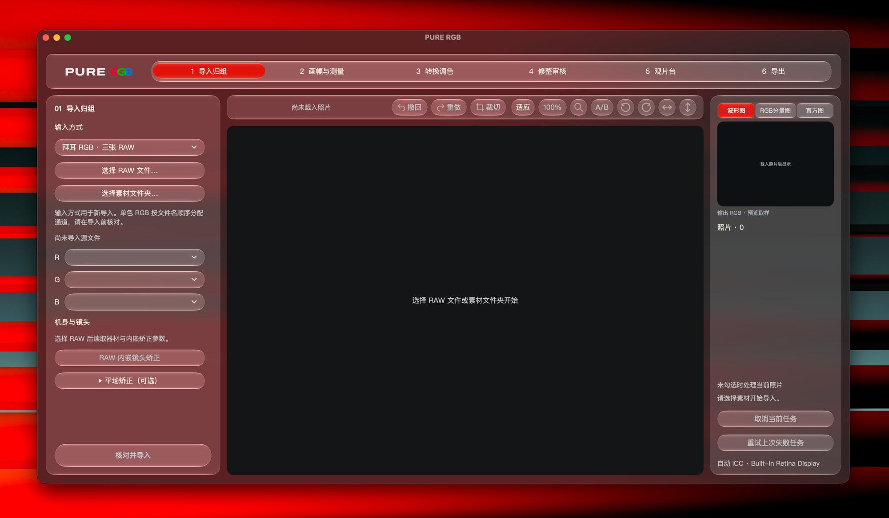
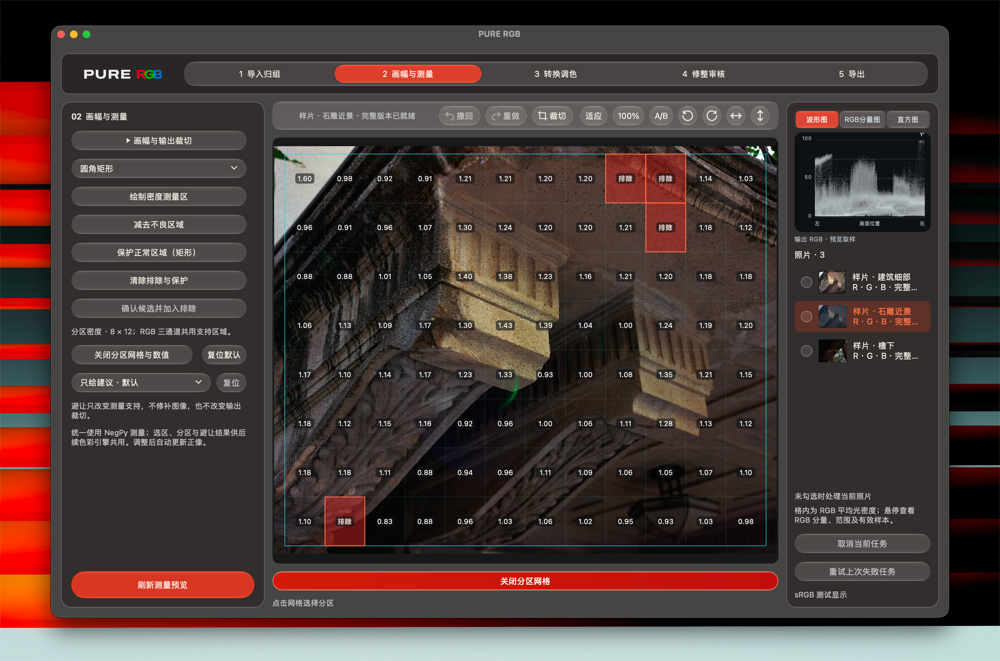
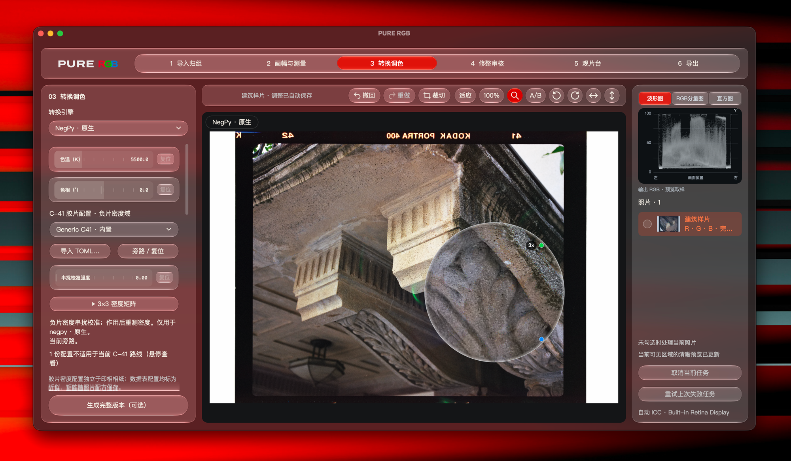
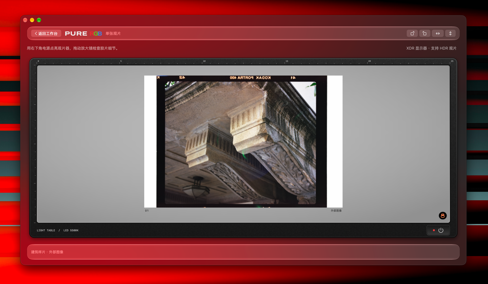

# PURE RGB 使用指南

**版本 0.2.2 · macOS / Apple 芯片**

PURE RGB 是基于 NegPy 0.68.0 开发的胶片数字化工作台。它把同一帧底片的红、绿、蓝三次独立 RAW 采集合成为一张照片，共用一套密度测量与画幅设置，再分别交给 NegPy、Nikon CMS 或 FlexColor 路线转换。默认使用完整 NegPy 原生测量；分区测量作为可选实验方式，供逐格查看统计和排除区域。另有独立的单张黑白负片流程。 [NegPy 上游](https://github.com/marcinz606/NegPy)

第一次使用时，在左侧选择输入方式，再选择 RAW 文件或素材文件夹。素材会自动归组并排队处理，无需逐张确认导入；每组都在右侧显示缩略图与处理状态。只想查看已经导出的照片，可以直接点顶部「5 观片台」，再点「打开图像文件…」。

首次使用介绍分为「三色拍摄」「光谱原理」「片基与曝光」「密度与转换」四章。可先看实拍对照和量区图解，再按需展开公式与参考资料。可随时选「稍后再看」或关闭，之后从应用菜单「首次使用介绍」重开。

图文介绍涵盖三色拍摄流程、染料吸收概念图，以及片基与平场的拍法对照。密度页用透射率 0.5 对应约 0.301 的相对片基密度解释对数关系。图示与数字均为教学示例。可展开「原理与来源」查看公式和资料出处。

## 导入前准备

Apple 芯片 Mac 可在 GitHub 发行页下载 PKG，双击后跟随安装助手将 PURE RGB 安装到「应用程序」。PKG 没有 Developer ID Installer 签名，应用使用本机临时签名，尚未通过 Apple 公证。若 macOS 提示无法验证开发者，先核对发布页上的 SHA-256。如确定来自本项目，可在「系统设置 → 隐私与安全性」中选择「仍要打开」，按系统提示确认。 [PKG 安装包](https://github.com/easonzhangbin/PURERGB/releases/download/v0.2.2/PURE-RGB-0.2.2-macos-arm64.pkg) · [Apple 官方说明](https://support.apple.com/zh-cn/102445)

源码运行时，在项目目录运行 `python3 bootstrap.py` 安装所需依赖，然后运行 `./PURE\ RGB.command` 打开工作台。依赖和可选研究资源的准备方式见 [项目 README](../README.md)。

打开应用时，如果有上次的任务，会先询问是否载入。选「是」会回到上次的项目和操作步骤；选「否」会打开一个空白项目，从「导入归组」选择新的 RAW。上次的项目仍保存在原目录。「取消启动」会退出，保留上次的项目选择。首次使用时直接打开空白项目。

| 素材 | 输入方式 | 可用路线 |
| --- | --- | --- |
| 同一帧底片，在 R、G、B 光源下由拜耳传感器分别拍摄的三张 RAW | 拜耳 RGB · 三张 RAW | NegPy · 原生、FlexColor · 演算（中性曲线）。配置本机资源后可用 Nikon CMS · 仅 CMS，以及 FlexColor 的本机资源配方。 |
| 同一帧底片，在 R、G、B 光源下由单色传感器分别拍摄的三张 RAW | 单色 RGB · 三张 RAW | 与拜耳 RGB 使用相同的三条彩色转换路线。 |
| 一张黑白负片翻拍 RAW | 黑白负片 · 单张 RAW | NegPy · 原生黑白，支持分区测量 |
| 一张白光下翻拍的彩色负片 RAW 或一张彩色成片 | 当前版本未提供彩负转换入口 | 使用三色采集素材，或在支持这种输入的软件中转换 |

三色采集时固定底片、相机、焦距、对焦和构图，每次仅切换照明通道。保留 RAW，并记录每张文件对应的光源。拜耳 RGB 支持 RW2 和符合导入条件的 CFA DNG。单色 RGB 接受单色传感器 RAW，包括带黑白位信息的单通道 DNG。已确认黑白位无法可靠确定的 P45 原始 IIQ 会提示使用带黑白位标记的单色 DNG。相机单张彩色 RAW 可经去马赛克形成 RGB 图像，其色彩信息来自一次照明和相机滤色阵列。PURE RGB 的三色路线要求三次已知照明条件下的独立观测；单张 RGB 图像中的三个数值不足以重新取得这三次测量。

## 图片库与采集辅助

### 图片库

点「导入归组」中的「图片库…」，或从菜单打开图片库，保存常用图片目录与项目入口，方便再次找到同一卷素材。选择目录后仍按工作台的输入方式归组三色 RAW。管理入口与原始文件分开：从库中移除目录、从处理列表卸载照片，都不删除原 RAW；移动原文件后应重新定位素材目录。

### RGB 拍摄灯光配平（可选）

三色照明、片基配平与 RAW 曝光余量的实拍和原理见 [中文九图指南](RGB_TRICHROME_GUIDE.zh-CN.md) · [English illustrated guide](RGB_TRICHROME_GUIDE.en.md)。

在提供此工具的版本中，「导入归组」里的灯光配平入口位于镜头矫正和平场上方，也可从「采集工具」菜单打开。窗口里的「配平指南」可随时打开。点「中英文说明」可阅读两份柯达资料的摘要和操作对照。先检查 RAW 曝光是否合适，再决定要不要调整三路灯光的相对强度。

1. **拍三张片基 RAW。** 把同一卷已冲洗、未曝光的片基固定在翻拍台上。保持相机 ISO、快门和光圈相同，只切换红、绿、蓝灯光，分别拍一张。按拍摄光色载入 R、G、B，软件会从每张 RAW 读取拍摄参数。
2. **确认橙框片基。** 可在确认蓝框之前移动和缩放橙框。把整个橙框放进三张 RAW 共有的同一块干净、已冲洗、未曝光的片基。橙框的位置取决于实际片基，可在蓝框内或蓝框外。片基很小时可缩小橙框取样。

   例如左侧是均匀的空白胶片，右侧有画面内容时，把橙框整个放进左侧胶片内的空白处，避开齿孔、胶片外的黑色区域、字样和片基与画面的过渡边缘。逐张核对后勾选「确认是同卷空白片基」。

   配平窗口可选用平场。点「载入平场…」选择一张平场 RAW 或已有的 NPZ 增益文件。点「已有平场…」可选项目或平场库中的配置，也可以跟随项目当前使用的平场。确认平场的机位、镜头、焦距、光圈、对焦和有效画幅与翻拍条件匹配。勾选「套用平场」后，左侧按校正后的片基信号计算偏差。右侧始终用原始 RAW 检查曝光余量。
3. **确认蓝框画幅。** 曝光检查默认使用「保留画幅」，载入预览后即可看到蓝框。初始蓝框供手动调整。拖动和拉伸蓝框，让它覆盖最终要保留的整张照片。按实际输出需求决定是否框入齿孔，再点「确认保留画幅」以取得该画幅的曝光建议。需要检查完整 RAW 时，可手动选择「整幅 RAW」。
4. **先看右侧 RAW 曝光余量。** 100% 是 RAW 白电平上限，试拍时应留余量。若剪切只在计划裁掉的齿孔或片外，将蓝框调到实际保留范围，确认后重测。保留画幅内有削顶风险时，按右卡提示缩短三路共用的快门。如果右卡显示「可试加曝光」，可用建议的较慢快门试拍。两种试拍都用同一个新快门拍完三路，保持灯光、ISO 和光圈，再复测曝光余量。
5. **再看左侧配平偏差。** 先确认片基有效。相对三路中位数的正偏差表示该路读数偏强，负偏差表示偏弱。三路均在 ±5% 内时保持灯光。最大偏差超过 5%、至多 10% 时，按原设置复拍确认。更大的偏差可按卡片提示的「增加」或「降低」方向，小幅调对应灯光。百分比估算的是有效曝光变化，灯具可调范围和刻度随设备而异。调整灯光时固定相机参数，然后重拍三张复测。

   增加单路灯光时还需核对保留画幅的原始 RAW 峰值。缺少可靠峰值、已有零星近上限或削顶点，或预计增加后的峰值达到 RAW 上限的 99.8% 时，软件暂不提供增加量。此保护不改变当前曝光风险的 P99.9／近上限点比例定义，也不改变配平 ±5% 的通过范围。
6. **保存可复用的参考。** 按灯具原刻度填写「本次灯具读数」中的 R、G、B，分析 RAW 前即可点旁边的「保存灯光参考…」，将读数写入 TXT 并设为当前参考。已有从 RAW 读取的实际拍摄参数时，会一并保存。分析完成后可点「保存报告…」选择 TXT 或 JSON，保存完整的分析结果、拍摄参数和已填写的灯具读数。下次通过「载入参考…」打开 TXT，或带有灯具参考的完整 JSON。

   使用同一台灯具和同一种刻度时，载入已经核对的参考，再输入当前旋钮的实际读数。「按参考调整灯具」会显示回到参考值需要增减的刻度。例如参考 R、G、B 为 24、42、69，当前为 20、45、69，则 R 增 4、G 减 3、B 保持。灯具以百分比显示时，增减量按百分点计。在设备上手动调整，随后复拍核对实际曝光与配平。更换设备或胶片，或改变光圈、快门后，应重新拍摄三张片基 RAW 测量。

**导入火眼。** 在支持 PURE RGB 报告的火眼版本中，可以导入「保存报告…」生成的完整 TXT 或 JSON，继续相机片基配平流程。完整 TXT 包含可读说明、灯具参考和完整测量数据，JSON 包含相同测量数据。导出联动报告前，应确认同卷空白片基和实际保留画幅，并处理信号无效或保留画幅的 RAW 削顶风险。使用「整幅 RAW」时，检查范围就是完整 RAW 画幅。配平以三路片基中位信号的中间值为共同目标，三路均在 ±5% 内时通过；最大偏差超过 5%、至多 10% 时复拍确认。

调整灯光后，按约定的相机设置、片基和量区重新拍摄三张 RAW，再分析并导出新报告。报告记录源文件内容身份和分析时间；同一组三张 RAW 的重复导出、重命名或重新分析，不能代替新的相机复拍验收。原 RAW 被同路径覆盖或发生变化时，保存完整报告前会要求重新分析并确认。「保存灯光参考…」生成的独立 TXT 没有完整片基测量，只用于复用灯具读数和拍摄参数，不能用于火眼测量联动或复拍验收。

### 平场匹配与镜头彩边

平场用于校正照明和镜头造成的空间不均。拍摄均匀白光参考时移开底片。同型号相机的平场可以按对应有效画幅匹配不同分辨率，文件占用多少 MB 不影响兼容性。镜头、焦距、光圈、对焦或灯位改变后，需要重新核对或拍摄参考。

「自动镜头色差矫正」针对镜头高反差边缘的红绿、蓝紫彩边。用「自动匹配」查找本机镜头配置，或点「选择 LCP…」指定已有的 Adobe 镜头配置。点「清除」可移除当前选择。可用配置优先，没有配置时采取保守的画面估计，证据不足时保持原图。检查时用 100% 或放大镜比较边缘，避免把正常物体颜色误判为镜头色差。「镜头畸变矫正」有独立开关。

本版读取本机可用的透视镜头 LCP；鱼眼和未知模型暂不套用。Adobe 数据库不随应用分发。机身 DCP 属于色彩配置，本版不将它直接套入窄带三色 RAW 的合成与密度计算。

## 六步操作

点顶部步骤可切换页面，也可拖动选中标记。再点当前步骤可展开操作卡，Esc 收起。画布上方有左转、右转、水平翻转和垂直翻转四个按钮。悬停可查看名称，也可用 Tab 聚焦后按空格操作。点「100%」旁的放大镜，再点照片上的细节查看。右侧示波器可点击模式名称，也可用左右键切换。

| 步骤 | 何时使用 |
| --- | --- |
| 1 导入归组 | 选择 RAW 并自动归组处理，按需检查光源通道与整卷平场。 |
| 2 画幅与测量 | 确认片框和密度测量区，排除片边、漏光等异常采样。 |
| 3 转换调色 | 比较正像、调整引擎与色调，用放大镜看局部。 |
| 4 修整审核 | 检查尘点并确认修复，可调整输出裁切与方向。 |
| 5 观片台 | 在独立窗口查看单张、挑选整卷或打开外部图像。 |
| 6 导出 | 单选、多选或全选照片，输出带 ICC 的 16 位 TIFF。 |

### 1. 导入归组

选择输入方式，再用「选择 RAW 文件…」或「选择素材文件夹…」加入素材。文件夹与多选素材会自动归组、依次处理，每一组先显示 RAW 缩略图，完成后替换为正式预览。单色 RGB 按文件名顺序初始分配三个通道。请根据实际照明顺序检查 R、G、B 下拉框；需要更改时，每个位置对应一张不同的 RAW，改好后用「应用通道更改」处理该组。

右侧照片列表支持单击单选、按住 `⌘` 单击多选、按住 Shift 连选，以及列表获得焦点后按 `⌘A` 全选。列表会显示已选数量；中央画布显示当前查看的照片。右键点击选中的照片并选择卸载，可一次从列表移除全部所选照片；右键未选中的照片只卸载该张。卸载保留原始 RAW、调整、除尘记录和保存版本，重新导入相同素材可恢复。卸载全部后，列表、预览、示波器及导出选择会清空。

对具备可识别镜头信息的拜耳三色 RAW，可启用「镜头畸变矫正」，使用选定 LCP 或 RAW 内嵌参数。单色 RGB 暂不支持此项。需要补偿照明不均时，展开「平场矫正」。拜耳 RGB 的 RW2 可选择同机位、镜头、光圈与对焦状态下移开底片拍摄的均匀白光 RAW，或已有的平场增益 NPZ。单色 RGB 可选择带完整传感器画幅记录的增益 NPZ；拜耳 CFA DNG 的平场入口暂不可用。0% 旁路，100% 采用完整平场校正，200% 施加两倍曝光校正量。增益作用在合成源上，三条彩色路线共用。单张白光参考校正照明不均与空间色偏，逐 LED 标定和暗场测量需要其他采集数据。

平场配置与强度按整卷共享。应用配置后，当前卷中兼容的照片统一使用，后续导入的新组自动沿用，无需逐张应用。软件会记住上次的平场设置，供下次导入继续使用；停用也会保存。更换相机、镜头、焦距或拍摄条件时，请重新核对参考配置。自动沿用不会取消原有兼容性检查。

素材加入列表后自动完成首次源准备与测量，无需逐张点击「核对并导入」。处理完成后即可进入「画幅与测量」。NegPy 的自动定位无法确认边界时，程序会用当前源的透射与正像定位图复核四边。彩色批量导入仍无法确认片框时，会先采用完整源四边各缩进约 10% 的中心区域测量，保留整张输出；之后可手动调整测量范围。

彩色三色 RAW 和单张黑白 RAW 导入时，初始密度测量取有效画面中心约 80% 的面积，保持原画面长宽比。已有确认裁切时，可用该画幅计算初始测量区。像素取整可能带来细微差异。画幅识别不确定时，自动导入保留临时预览，并提示「框选有效画幅并测量中心 80%」。也可用「绘制密度测量区」直接使用所画范围。重开项目会沿用保存的测量区。未完成的自动导入会继续排队，暂停后可用「继续批量处理」恢复。

### 2. 画幅与测量

先核对测量方式。默认的完整 NegPy 原生测量保留上游的精细采样、亮度范围和颜色端点规则，预览与导出使用相同方式。选区应覆盖具有代表性的有效画面，尽量避开片边、齿孔和已知的漏光或冲洗异常。

拖动白点、黑点和范围截断滑块时，先显示小尺寸预览。松手并短暂停留后，软件按完整来源重算测量。100% 视图会随后补上可见区域的原像素预览。

测量高级参数位于「绘制密度测量区」「减去不良区域」下方，默认展开，仍可手动收起。彩色原生方式下，「NegPy 原生测量参数」可调整白点、黑点偏移及亮度／颜色范围截断。白点与黑点偏移默认均为 0；白点负值保留更多高光，黑点负值加深暗部。截断使用 NegPy 的 −100 至 100 标尺，负值更温和，复位恢复原生默认值。与 NegPy 对比时，也应核对这些保存的调整，以及平场、胶片串扰强度、相纸和自动印相设置。使用同一测量算法并不会自动复制另一软件已保存的参数。实验分区暂不支持这些原生端点与截断调整；切换前请将其复位。

需要使用网格与区域排除时，主动切换到分区实验方式。在「绘制密度测量区」前可选择矩形、圆角矩形、椭圆或手绘套索。分区默认 8 行 × 12 列，每格 2 × 2 个测量子块。该方式会改变统计和密度端点，不能视为完整 NegPy 原生测量。

- **查看分区**。格内数字概览该区的 RGB 光密度。悬停可看三通道中位光密度、分位范围、有效像素和有效子块数。
- **排除或恢复**。点击网格中的一格，选择「排除该分区」或「恢复该分区」。格子的颜色显示排除状态，预览和测量数值会重新计算。仍在计算时显示「待更新」。常用的撤回和重做为 `⌘Z` 和 `⇧⌘Z`。
- **画出不规则坏区**。用「减去不良区域」指定局部排除。开启自动避让时，可用「保护正常区域（矩形）」保留容易被误判的正常画面。默认「只给建议」，可检查候选后用「确认候选并加入排除」纳入测量。
- **单独管理网格**。用「显示分区网格与数值」或「关闭分区网格」切换显示。「复位默认」恢复网格尺寸与子块数，保留当前测量范围及排除设置。「清除排除与保护」用于清除这些设置。

*PURE RGB 实际分区密度界面，预览为实拍建筑胶片样片。*

输出画幅在「裁切、拉直与旋转」中手动设置。可绘制裁切范围、拖动裁切框四角和旋转手柄，也可沿参照线画线拉直。裁切、拉直角度、空白角裁除和旋转／翻转随照片在各引擎间继承。两个自动裁切入口已移除。测量排除只改变密度计算所用的像素集合，照片中的对应区域仍然保留。需要去除实际瑕疵时，到「修整审核」操作。

### 3. 转换调色

在「转换引擎」菜单切换路线。参数滑块可在刻度轨道上点选或拖动，拖动时显示读数，聚焦后用方向键逐步微调。「复位」只还原旁边的参数。先用同一画幅、同一测量范围比较正像，再调整选定引擎的曝光、色温、色相、色彩平衡及可用的高级参数。引擎各有独立的调色草稿，测量结果和输出几何属于整张照片。

中央画布支持滚轮缩放、适应和 100% 查看。画面双击在 100% 与适应之间切换。点「100%」右侧的放大镜，再点照片定位。镜片默认直径 288 点，按画布当前比例放大 3 倍。拖动镜面或按方向键移动，按住镜面可临时提高倍率。蓝点调镜片大小，绿点、镜内滚轮或触控板捏合调倍率（1.5× 至 8×）。键盘 + / − 调倍率，配合 Option 调大小。按 Esc 退出。右侧波形图、RGB 分量图和直方图取自输出 RGB 预览，采用显示器 ICC 转换前的信号值。画布中的 A/B 用于对照当前正像和参照版本。

在 NegPy 原生路线的「C-41 胶片配置」里，首次安装可选 Generic C41 和 22 份按数据表估算的配置。用「导入 TOML…」为当前配方选用实测矩阵。本机 NegPy 个人目录里的标定会另外列出，因此不同电脑上的菜单可能不同。

「自动印相密度」「自动反差」开启时，高级参数中的数值是计算基准；本次实际印相密度和 ISO-R 反差显示在更新后的画面左上角。切换胶片串扰配置时会保留当前强度，胶片密度配置与印相相纸分别选择。

用三张 RAW 的 NegPy 原生路线提供「印相曝光（EV）」。它沿用当前密度测量，从相纸曲线前的负片密度计算曝光调整后的亮度，再在输出编码前等比例调整每个像素的 RGB，保持原有色彩比例。负值压暗印相并展开 RAW 已记录的亮部层次，正值提亮。「正像曝光（EV）」用于转换完成后的整体明暗微调。拍摄时已剪切的细节需要降低相机曝光后重拍。旧版已保存成片可继续导出，重新生成完整版本后会应用更新的印相曝光。

在 NegPy 原生彩色负片模式下，「高光找回强度」读取相纸曲线之前的三路负片密度，沿用 NegPy 的印相颜色，把接近相纸白的亮部平滑映射进 SDR 输出范围。0% 为普通印相，100% 为完整映射。可用「印相曝光（EV）」决定整体印相明暗，再用「高光找回强度」调整亮部过渡。两项都在输出编码之前生效。旧项目保留之前的找回效果，首次操作新滑杆后采用新的映射。

分区测量和黑白工作流仍可使用局部高光工具。青色框为高光参考，绿色框为人物／中间调保护区，橙色框限定作用范围。边缘会自动柔化，可调节作用区羽化半径。点击「恢复高光全图作用」会移除橙框。重新启用局部高光时会沿用此前保存的区域。

旧项目中使用局部高光选区的成片会提示重新生成。重新生成时，同一来源的照片会沿用已确认的隐藏除尘数据；常规裁切、拉直、旋转及翻转后的修复范围会映射到新画幅。也可在导出页选择「导出当前照片的已保存旧版」，使用原成片及其已确认除尘。

调整会自动保存。若要保留当前配方的一份完整渲染，可点「生成完整版本（可选）」。右键点击照片缩略图，可复制调整、在粘贴时选择要应用的项目，或将该照片还原为首次导入状态。

### 4. 修整审核

需要除尘时，在 macOS 的 `/Applications` 安装独立的 **PURE Neg.app**，然后打开「修整审核」中的 PURE Neg 入口。PURE RGB 是宿主，负责准备当前配方的完整 RGB16 正像、提供审核画布和操作控件，并把处理结果接回当前项目。独立安装的 PURE Neg 通过隔离的命令行进程负责检测与修复，其本体和模型由该应用单独提供。没有安装 PURE Neg 时，仍可完成导入、测量、转换和普通导出。 [PURE Neg 下载与发行说明](https://github.com/easonzhangbin/PURENeg/releases)

在审核界面可查看原图、修复后画面和分割对比。检查点位后可在列表中取消某次自动修复，用画笔补修或用橡皮擦恢复原像素。预览会自动更新，笔划支持撤销和重做。画笔半径记住上次设置，切换照片或重新打开软件后沿用。核对后点击「确认并应用到工作台」，也可用「确认并另存修复结果…」保存独立副本。

*PURE RGB 实际除尘审核界面，预览为实拍建筑胶片样片。*

确认后，除尘作为隐藏修复数据随照片保存。可返回转换调色、切换兼容引擎或重新打开项目；调整曝光、白平衡等颜色参数后，会在新像素上重新应用已经审核的修复范围，保留手动画笔与橡皮擦结果。独立裁切、拉直、90° 旋转和翻转后，修复范围会自动映射到新画幅，继续用于预览与完整导出，无需因这些操作重复除尘。

PURE RGB 在接收结果时核对来源版本、图像尺寸、RGB16、嵌入 ICC 和蒙版，检查映射后的修复范围外像素保持一致。原审核记录和蒙版不改写，撤回几何编辑后可以恢复原画幅。扩展裁切时，原审核范围之外的新区域不会自动生成未经确认的修复。更换 RAW、平场或配准，以及改变透视／径向畸变后，仍需按提示重新审核。

### 5. 观片台

观片台位于「修整审核」与「导出」之间。它使用随 PURE RGB 安装的原生观片器，可独立打开。

- **查看当前照片。** 点右下角电源点亮灯板，拖动放大镜检查细节。底部状态会标明当前调色预览、保存版本或已确认除尘。点左上角「返回工作台」继续调色。
- **整卷观片。** 点击底片将照片移入候选区，再点一次移出。选择结果同步到工作台右侧照片列表。点「前往导出」后核对照片和输出目录。
- **打开外部图像。** 点「打开图像文件…」选择已有的 TIFF、JPEG、PNG 或 HEIF。选一张进入单张观片，选多张可浏览整组。

从 Mac 的内建 XDR 屏打开会自动全屏，按 Esc 退出全屏。外接 SDR 屏默认使用窗口；在多个显示器间移动窗口时，右上角提示会更新。完整 HDR 观片体验需要 XDR 显示器及支持 HDR 的显示模式，HDR 灯板使用 macOS 26 或更新版本。屏幕亮度与显示设置会影响实际可用的高光亮度。

### 6. 导出

在右侧照片列表单选、多选或全选，再选择导出目录。导出按钮会显示所选数量，只导出这些照片；取消全部选择后，导出按钮停用，不会自动改为导出当前照片或整卷。

导出按各照片当前配方生成完整 TIFF，使用 16 位 RGB 并嵌入实际 ICC，已有同名文件会保留。黑白正像也使用这一封装。导出不需要提前手动生成完整版本。

## 设计原理

### RGB 翻拍的光谱观测

冲洗后的彩色胶片主要以青、品红、黄色染料形成影像。各染料除主吸收波段外，还会吸收其他波段，称为侧吸收；彩色负片的橙色校正罩也会影响观测。选择合适的窄波段，可减少部分侧吸收和波段重叠的影响，改善色分离。波段选择、胶片材料、传感器与后续色彩模型仍会影响结果，窄带不等于零串扰或自动获得准确色彩。[Flueckiger 等，2018，第 2.1–2.3 节](https://scan2screen.com/wp-content/uploads/2026/06/flueckigeretal_investigationfilmmaterialscannerinteraction_2018_v_1-1c.pdf)

扣除黑电平后的信号由曝光时间、照明光谱、胶片透射和传感器响应共同决定，可简写为 `s_c − b_c ∝ t_c ∫ L_c(λ) T(λ) Q_c(λ) dλ`。若要观察当前装置下的片基透射，可固定 ISO、快门和光圈，分别拍摄同卷已冲洗、无画面的片基在红、绿、蓝照明下的线性 RAW。小块片基也可作为局部参考，取样时避开齿孔、字样和阴影。

Kodak VISION3 500T 技术资料第 4 页区分了两类曲线：光谱感光度描述乳剂在拍摄曝光时的响应；光谱染料密度描述冲洗后染料的吸收，后者用于理解扫描。染料曲线按峰值归一化，不是本机灯具与相机的联合标定。[Kodak VISION3 500T 5219/7219 技术资料](https://www.kodak.com/content/pdfs/motion/KODAK-VISION3-500T-5219-7219-technical-information.pdf)

以未曝光、已冲洗片基作为线性透射参考，以及将扫描波段与后续印相模型分别处理，可参考 Trumpy 与 Anderson 的研究；该文的有限样例不能证明所有胶片与扫描装置都能获得相同还原效果。[From Negatives to Positives，2025](https://doi.org/10.2352/issn.2168-3204.2025.22.1.33)

输出位深也不同于采集动态范围。Kodak 的扩展动态范围扫描建议优先考虑 16 位编码，同时要求扫描器的光电系统本身能测得所需密度范围；将较弱或已削顶的采集写成 16 位文件，不能增加源文件已经缺失的信息。[Kodak 扩展动态范围胶片扫描建议](https://www.kodak.com/content/products-brochures/Film/Scanning-Recommendations-for-Extended-Dynamic-Range-Camera-Films-EN.pdf)

进一步阅读可参考以下原始资料，分别理解波段选择、特定材料的侧吸收分离和工业设备的稳定性设计。

| 资料 | 可参考的内容 |
| --- | --- |
| [Trumpy 与 Flueckiger，2015，Light Source Criteria for Digitizing Color Films](https://scan2screen.com/wp-content/uploads/2026/06/trumpyflueckiger_lightsourcecriteria_2015.pdf) | 采集波段需结合材料和目标选择，信息提取与外观复制有各自要求。 |
| [Trumpy 与 Flueckiger，2018，Dye Purification](https://scan2screen.com/wp-content/uploads/2026/06/trumpyflueckiger_dyepurification_2018.pdf) | 利用吸光度可加性分离侧吸收的具体研究，所需光谱测量与材料条件不能省略。 |
| [ARRI ARRISCAN XT 原厂规格](https://www.arri.com/en/cine-systems/archive-technologies/arriscan-xt) | 工业扫描结合 RGB/IR、灯光闭环与积分球均匀照明；是设备工程参考。 |

NegPy 的相机采集指南记录了共享拍摄设置、逐通道测量片基和检查曝光上限的做法。 [NegPy 相机采集与校准](https://github.com/marcinz606/NegPy/blob/d8123a9b2a18fdaab5941347a91e402fa936d3dc/docs/CAMERA_SCANNING.md)

2018 年扫描研究第 3.3 节（正文第 32–34 页）记录了 ARRISCAN 使用校准后的线性透射数据、局部选区与 RGB 直方图设定扫描工作点。 [原研究第 3.3 节](https://scan2screen.com/wp-content/uploads/2026/06/flueckigeretal_investigationfilmmaterialscannerinteraction_2018_v_1-1c.pdf)

### 采集范围、浮点密度与输出编码

采集时，较透的片基应留在可用上限以下，密部则要获得足够光子，避免弱信号被读出噪声和颗粒起伏淹没。提高软件增益不能补回削顶，也不能凭空改善已经采得的密部信噪比。

在提供「RGB 拍摄灯光配平」的版本中，橙框内的同卷空白片基用于比较三路信号的相对偏差。选用平场时，比较使用校正后的片基信号。选择「保留画幅」时，右图读取经用户确认的蓝框范围内的原始 RAW 感光点。100% 是相机 RAW 白电平上限，采集时应给它留余量。快门建议供下一组三色试拍使用。保持三路灯光、ISO、光圈和蓝框一致，改用相同的新快门后复拍复测。

配平工具参考柯达 D-min 片基参照与扩展动态范围扫描建议设计。D-min 对应未曝光负片冲洗后的最低密度。扫描建议关注完整记录胶片的密度范围。PURE RGB 定义相机三色翻拍的取样流程、配平分档和快门试拍判据，并根据保留画幅的原始 RAW 实测给出建议。[柯达 H-61A](https://www.kodak.com/content/products-brochures/Film/LAD-for-KODAK-Color-Negative-Film-H-61a.pdf) · [柯达扩展动态范围胶片扫描建议](https://www.kodak.com/content/products-brochures/Film/Scanning-Recommendations-for-Extended-Dynamic-Range-Camera-Films-EN.pdf)

柯达 LAD 标准片用于印片过程控制。18% 灰卡用于记录原场景的曝光和中性灰参考，供后续转印或调色。[柯达印片 LAD H-61B](https://www.kodak.com/content/products-brochures/Film/LAD-for-KODAK-VISION-Color-Print-Film-H-61b.pdf) · [柯达灰卡使用说明](https://www.kodak.com/en/motion/page/gray-card/)

现有标准三色导入将固定尺度解码的通道合成为浮点线性源，再进行对数域的密度测量与换算。密度、印相曲线、正像调整与输出编码是不同阶段：改变曲线可以重新安排已有细节的亮度与反差，但不会扩大相机实际采集的范围。线性透射值与对数密度也不是同一种数值。

最终的 16 位 TIFF 与嵌入 ICC 用于表达处理后的 RGB 结果。更精细的编码不等于新增真实动态范围，也不等于整条管线完成了绝对密度标定。HDR 包围曝光、灯具响应曲线、噪声测量和 LAD 标定各自需要额外的采集与验证。

### 以源坐标组织密度测量

三色 RAW 经通道核对、解码及源准备，合成为定向后的线性透射图。密度运算在源像素坐标下进行，因此显示缩放、翻转、旋转与输出裁切不会把测量区域移到另一处。像素级光密度可写为 `D = −log₁₀(T)`，其中 `T` 是用于测量的线性透射信号。举例来说，在以 1 为参照且透射信号已归一化的情况下，`T = 0.1` 对应 `D = 1`。实际界面读数取决于采集、平场和内部信号尺度；绝对光密度需要额外的参照和标定。

默认测量使用 NegPy 原生的精细分析网格，分别确定亮度范围与颜色参考，再组合密度端点。所选方式保存于配方，预览与导出不会中途改用另一套测量。

可选的分区实验方式把选区拆成网格及更小的子块，在每个保留子块内求各通道对数信号的中位数，再按参与的源像素面积汇总统计分布。三个通道共用空间掩模和面积权重，但各通道分位端点不保证来自同一批像素，因此与默认原生测量存在区别。自动建议以测量支持为目标，均匀天空、强烈色彩或高反差本身不足以判定胶片受损。

### 三条色彩路线的关系

| 路线 | PURE RGB 中的处理 |
| --- | --- |
| **NegPy · 原生** | 继承 NegPy 的密度归一化及负片至正像处理，使用 PURE RGB 的测量选区与排除结果，提供胶片、印相相纸与正像调色控制。单张黑白使用 NegPy 的独立黑白流程。 |
| **Nikon CMS · 仅 CMS** | 使用同一密度测量生成未经引擎专属调色的 Native RGB16 参考正像，可选固定 LUT，再运行研究版 CML4 色彩管理阶段，按实际输出 ICC 转到共同工作空间。 |
| **FlexColor · 演算** | 源码首发默认用共用密度窗归一化 RGB 信号，采用公开算法和自带中性曲线转换正像，再将色调端点拟合到 Native 参考。使用已验证的本机资源配方时，从同一密度窗产生正向密度值，进入 RGB14 曲线、ColorMap、Lightness 和 ICC 转换，并可调整原曲线参数。 |

Nikon Scan 的公开逆向资料记录了利用预扫估计每帧片基和通道范围，再生成 R、G、B 各自的负片反演 LUT 的路径。选用 Nikon 引擎时，PURE RGB 默认走上表的仅 CMS 路线。逐帧 analyzer／LUT 功能单列为「未标定」实验。相机合成的 RGB 要与扫描仪原始码值建立对应，仍需额外标定。公开源码不附带或自动获取 Nikon 的受限 LUT、ICC 或预扫测量表。使用相应功能前，请按 README 准备已获授权的本地资源。 [cool-colors](https://github.com/rohanpandula/cool-colors) · [nkscan](https://github.com/activexray/nkscan)

Hasselblad／Imacon FlexColor 的公开研究资料记录了独立的胶片与传感器资源。胶片配置包含 `Gradations` 曲线、`ColorCorr` 色彩校正数据和 ICC 引用，传感器配置还包含设备专用 3 × 3 矩阵和校准表。FlexColor 的中性曲线可直接用于新项目。程序在首次建立 Flex 草稿时读取可用的本机研究配方；有效配置会启用胶片原曲线与六色校正等控件。原厂 DLL、私有胶片资料与设备专用标定不随源码分发。 [flexcolor-tool 资源结构与处理说明](https://github.com/rohanpandula/flexcolor-tool)

两家的扫描硬件都提供设备特定的颜色观测。以 Nikon COOLSCAN 4000 ED 为例，设备用 RGB LED 分色；Hasselblad Flextight X1／X5 的规格则列出三线 CCD。PURE RGB 用相机的三次照明观测作为研究路线的输入，采用的是各自的适配假设。两条路线的实际呈现可用于对照与调色，原厂等效还需扫描仪光谱响应、相机到扫描仪的输入标定，以及同帧底片的参考扫描。 [Nikon COOLSCAN 4000 ED 手册](https://www.nikonusa.com/pdf/manuals/scanners/LS4000_40_en.pdf) · [Hasselblad Flextight X1／X5 技术规格](https://cdn.hasselblad.com/manuals/flextight/uk_x5_x1_datasheet_v4.pdf)

### 工作台界面

六步工作流从导入延伸到独立观片与导出。顶栏负责按步骤导航，左侧面板集中当前阶段的参数，中央画布用于预览和直接编辑，右侧把示波器、照片与任务状态放在一起。裁切框、测量区与可点击密度网格叠在正像上，用户可在原画面位置完成评估与调整。绘制、确认和退出需要用户动作时，按钮会通过重点色提醒。

窗口底层使用较厚的磨砂背景。顶栏、工具和面板使用较透明的原生玻璃，橙红色标出选中的步骤和主要操作。控件会跟随 macOS 的深浅外观。运行环境无法加载 SwiftUI 材质时，窗口会回退到 AppKit 材质。工作台自己的布局、网格、工具状态和颜色指示与系统材质衔接。PURE Neg 审核继续沿用同一界面语言，检测与修复交由独立后端完成。

界面截图的桌面壁纸由 Milad Fakurian 创作，按 Unsplash 许可使用。 [壁纸原作](https://unsplash.com/photos/red-and-black-horizontal-striped-abstract-background-WlFOb5WgWvY) · [许可](https://unsplash.com/license)

## 0.2.1 改进与故障处理

- **先除尘，再裁切与调色。** 已确认修复数据随照片保存；曝光、白平衡、兼容引擎切换以及常规裁切、拉直、旋转与翻转可继续沿用。画笔半径也会保留上次设置。
- **启动时找不到窗口。** 本版使用随应用安装的 Cocoa 插件，修复旧插件缓存造成的启动闪退。启动询问框支持鼠标与键盘。选「否」打开新的空白工作台，按 Esc 取消启动。
- **检查原图细节。** 工作台按需载入镜片所在位置的高清区域。在照片边缘定位时，镜片会向画布内让位，仍采样选中位置。检查输出前，可到观片台查看已保存版本。
- **批量导入与片框识别。** 文件夹或多选 RAW 自动归组处理，列表会先显示每组缩略图。彩色批量导入无法确认片框时，先用中心区域测量，保留整张输出；随后可在「画幅与测量」绘制有效范围。校验平场或生成预览失败时，可在右侧查看任务信息，修正来源后重试。
- **全选卸载与恢复。** 在所选照片上右键卸载，一次移除全部所选项目；重新导入相同 RAW 可恢复原调整和保存版本。原始 RAW 保留。
- **提示与稳定性。** 错误、确认、更新及除尘提示统一居中并按实际字体换行；修复批量照片列表崩溃和临时 TIFF 元数据变化引起的除尘误报。

## 应用菜单、支持与更新

在 macOS 菜单栏点 **PURE RGB**，可以直接使用以下入口。

| 菜单项 | 用途 |
| --- | --- |
| 关于 PURE RGB | 查看当前版本、项目说明和捐助者名单。 |
| 首次使用介绍 | 重新查看三色拍摄、光谱原理、片基与曝光及密度与转换。 |
| 使用指南 | 打开随应用提供的中文图文指南，离线也可阅读。 |
| 捐赠 StudioPURE 项目 | 查看项目二维码及捐助者名单，用支付宝自愿支持项目。 |
| 检查更新 | 立即查询 GitHub 正式发布通道，查看可用版本。 |

应用启动后会在后台检查新版，持续运行时每 24 小时再查一次。出现「查看更新」时，点击进入 GitHub 发布页，阅读本次变化并下载安装包。安装前请保存任务并退出旧版。已有用户升级至 0.2.2 后首次启动，右侧会显示本版主要改进。也可从「设置 → 通用 → 检查更新」主动查询。 [0.2.2 发布页](https://github.com/easonzhangbin/PURERGB/releases/tag/v0.2.2) · [GitHub Releases](https://github.com/easonzhangbin/PURERGB/releases)

感谢捐助者 **nothing老庄、J3RRYK33PF1T、熊小默、基岩、一笑而过**。[捐赠 StudioPURE 项目](https://github.com/easonzhangbin/PURERGB/blob/main/SUPPORT.md)

提交问题时，附上应用版本、macOS 版本、输入方式、引擎和复现步骤。可在「设置 → 维护」保存诊断报告，分享前请检查截图和报告中的个人信息。[GitHub Issues](https://github.com/easonzhangbin/PURERGB/issues)

Nikon、Hasselblad、Imacon 和 FlexColor 用于标识研究对象及兼容路线。开源基座、研究参考及其许可范围见[第三方声明](../THIRD_PARTY_NOTICES.md)。
