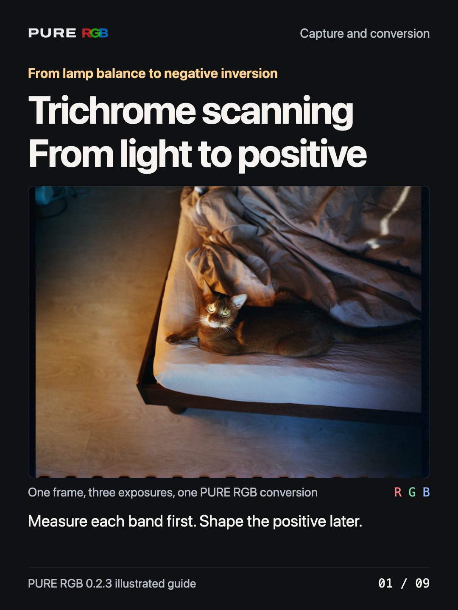
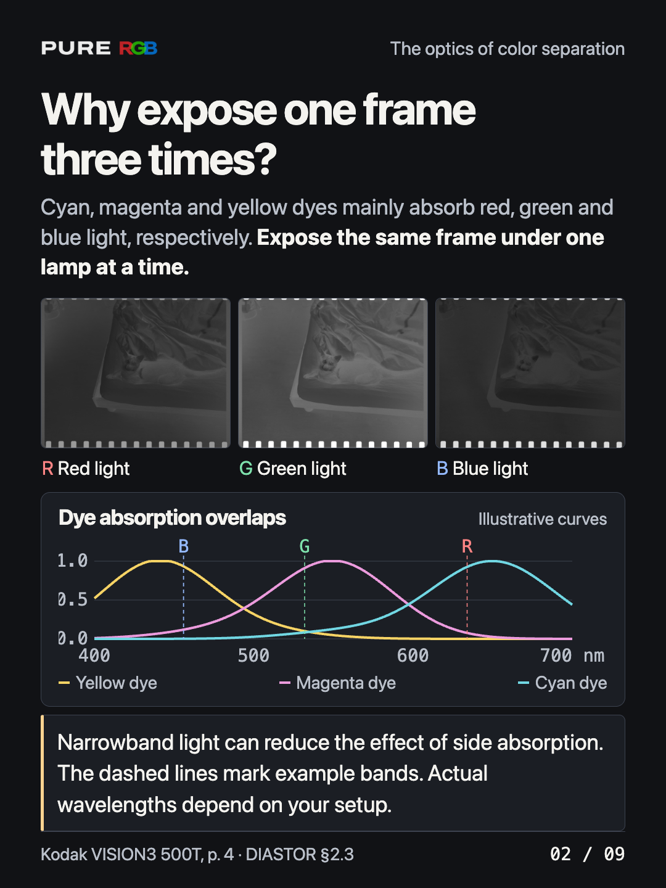
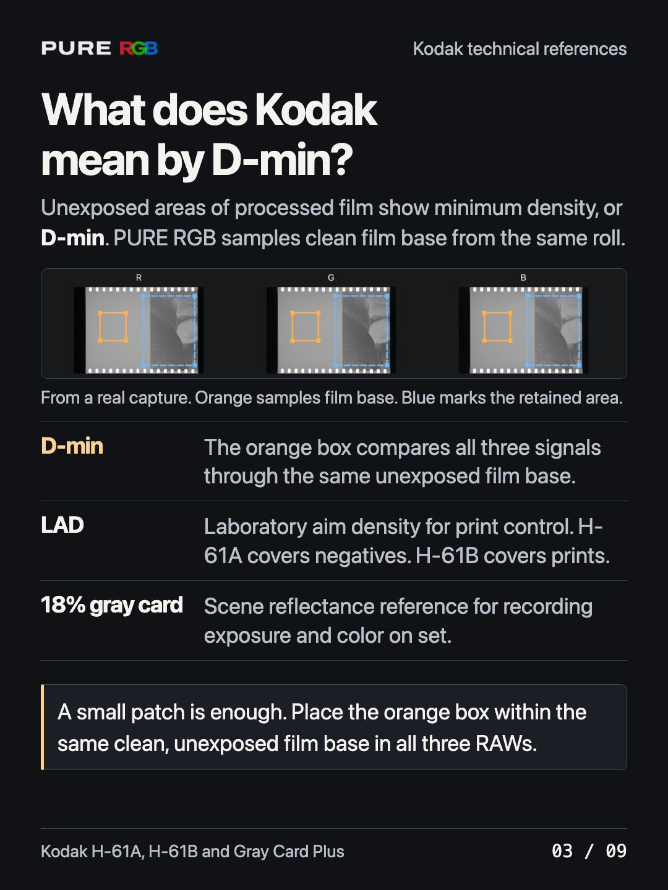
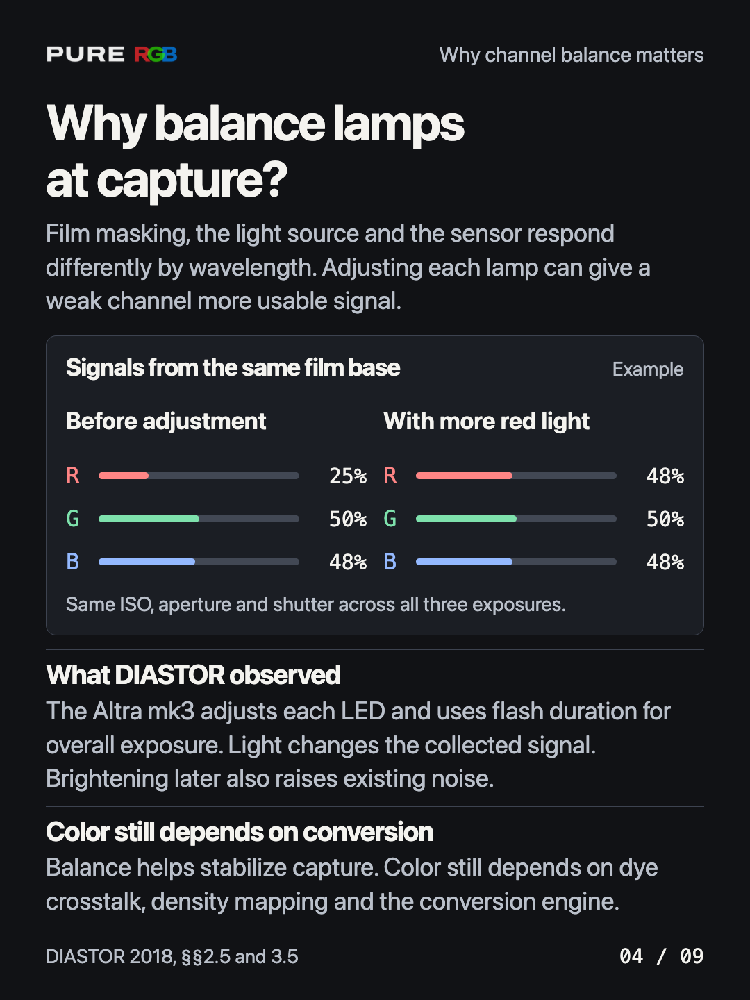
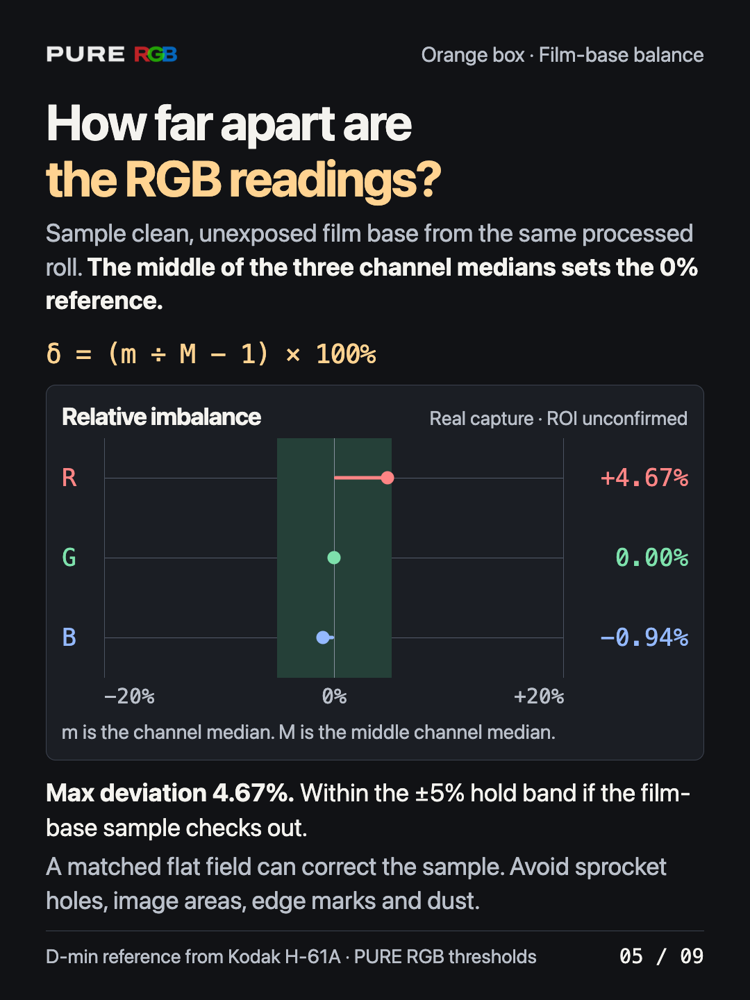
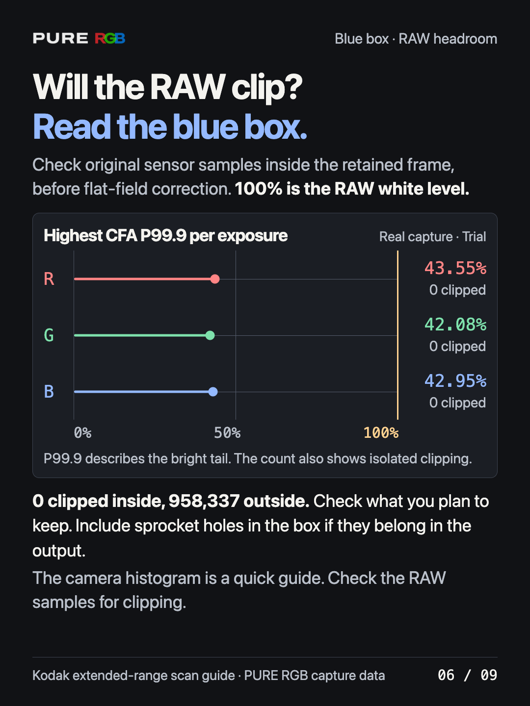
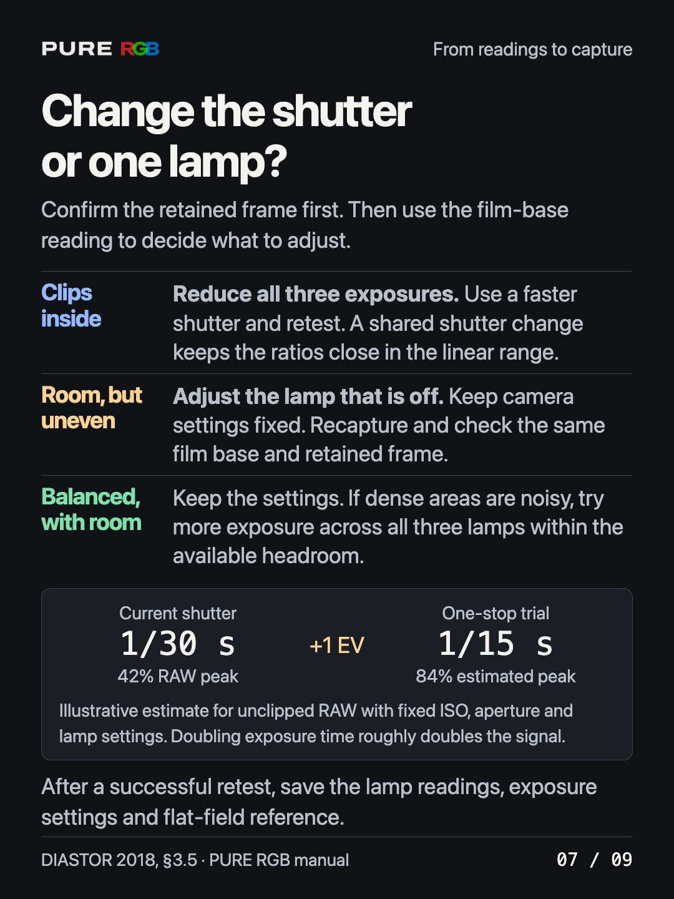
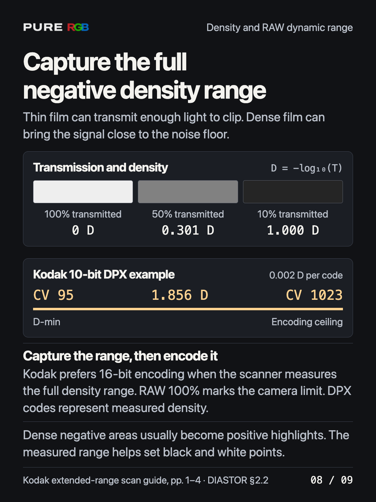
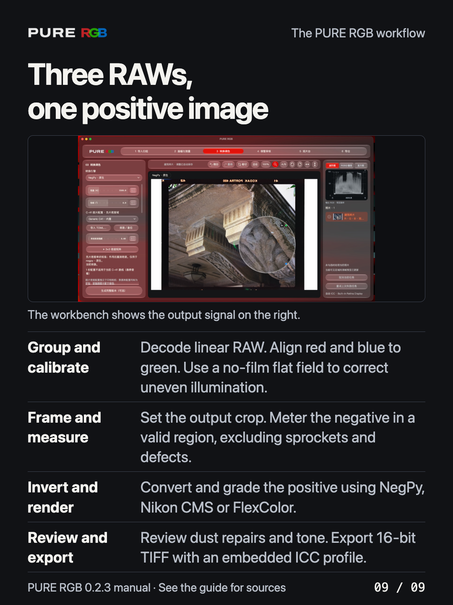

# RGB trichrome film capture with PURE RGB

[简体中文](RGB_TRICHROME_GUIDE.zh-CN.md) · [Operating manual (中文)](OPERATING_MANUAL.zh-CN.md) · [RGB balance reference notes](RGB_LIGHT_BALANCE_BILINGUAL.md)

## 1. Three exposures, one frame

*One film frame, photographed in three separate RAW exposures and rendered as a color positive in PURE RGB 0.2.3.*

Keep the film, camera and focus fixed. Capture the frame once under each of the red, green and blue lights. PURE RGB combines the corresponding measurements into one source image, then maps the negative to a positive.

## 2. What the camera measures

*The curves illustrate spectral overlap. Actual curves depend on the film, light and sensor.*

The cyan, magenta and yellow dyes in processed film absorb across wavelength ranges that can overlap. Carefully chosen narrow bands can reduce the influence of side absorption. With aperture and gain fixed, the black-level-subtracted signal can be expressed as `S − B ∝ t · ∫ L(λ) T(λ) Q(λ) dλ`. Here `t` is exposure time, `L` is illumination, `T` is film transmittance and `Q` is the response of the sensor and optics. Kodak’s 500T data sheet plots the film’s sensitivity during exposure separately from the dye densities after processing. [Kodak VISION3 500T, p. 4](https://www.kodak.com/content/pdfs/motion/KODAK-VISION3-500T-5219-7219-technical-information.pdf#page=4) · [DIASTOR 2018, §2.3](https://scan2screen.com/wp-content/uploads/2026/06/flueckigeretal_investigationfilmmaterialscannerinteraction_2018_v_1-1c.pdf#page=15)

Suitable wavelengths depend on the film and digitization goal. [Trumpy and Flueckiger, *Light Source Criteria for Digitizing Color Films* (2015)](https://scan2screen.com/wp-content/uploads/2026/06/trumpyflueckiger_lightsourcecriteria_2015.pdf#page=2).

## 3. Three reference points

*Film base, laboratory print control and the original scene each provide a different reference.*

| Reference | Where it is used |
| --- | --- |
| **D-min** | The minimum density of the processed negative. Kodak H-61A illustrates it with a region that received virtually no exposure. PURE RGB uses a clean, processed, unexposed piece of the same roll as the reference for comparing the three captures. |
| **LAD** | Laboratory Aim Density controls photochemical printing. The negative and print-film guides give their respective reference patches and density aims. |
| **18% gray card** | A neutral reference photographed in the original scene to record exposure and lighting for transfer or grading. |

[Kodak H-61A negative LAD](https://www.kodak.com/content/products-brochures/Film/LAD-for-KODAK-Color-Negative-Film-H-61a.pdf) · [Kodak H-61B print LAD](https://www.kodak.com/content/products-brochures/Film/LAD-for-KODAK-VISION-Color-Print-Film-H-61b.pdf) · [Kodak gray-card guide](https://www.kodak.com/en/motion/page/gray-card/)

Trumpy and Anderson used unexposed film as the transmittance reference in their study of digital inversion and modeled the response of the printing paper separately. [*From Negatives to Positives*, IS&T Archiving 2025](https://library.imaging.org/admin/apis/public/api/ist/website/downloadArticle/archiving/22/1/33#page=2)

## 4. Why adjust the lamps at capture

*Illustrative levels show why each lamp and overall exposure are adjusted independently.*

The film’s mask and the camera’s spectral response can give the same unexposed film base different RAW levels under the three lamps. Adjusting the lamps individually can make better use of the available sensor range. DIASTOR describes this approach for masked negatives. In its Sondor Altra mk3 case study, the operator used a selected gray image point to adjust the individual LED intensities. A separate control changed flash duration. PURE RGB applies this separation to camera capture, using same-roll film base to compare lamps and the retained frame to check RAW headroom. [DIASTOR 2018, §2.5](https://scan2screen.com/wp-content/uploads/2026/06/flueckigeretal_investigationfilmmaterialscannerinteraction_2018_v_1-1c.pdf#page=17) · [Sondor Altra mk3 case study, §3.5](https://scan2screen.com/wp-content/uploads/2026/06/flueckigeretal_investigationfilmmaterialscannerinteraction_2018_v_1-1c.pdf#page=42)

## 5. Orange box · compare the film-base readings

*This trial measured a maximum deviation of 4.67%. The film-base reference was still awaiting confirmation.*

For the optional **RGB Light Balance** tool, capture the same piece of processed blank film under each lamp at the same ISO, shutter speed and aperture. Place the whole orange box on the same unexposed area in all three captures. Avoid image content, sprocket holes, lettering, shadows and transition edges. The orange box may sit outside the blue box.

The tool compares each channel’s median film-base signal with the median of those three readings. With a matching flat field enabled, it measures the corrected film-base signal in the orange box. Once you confirm the reference, the largest absolute deviation determines the action.

| Maximum deviation | Action |
| --- | --- |
| Up to 5% | Keep the lamp settings |
| Over 5% through 10% | Retest |
| Over 10% through 15% | Adjust and retest |
| Over 15% | Significant imbalance. Adjust and retest |

## 6. Blue box · check the retained frame

*This trial recorded 0 clipped photosites inside the selected area and 958,337 outside it. The selected frame was still awaiting confirmation.*

Use the blue box to enclose the entire intended output, including sprocket holes if you plan to keep them, then confirm the retained frame. The blue chart reads the original CFA photosites, independently of any flat-field gain. **100% is the RAW white-level ceiling.** The bars show the highest CFA-group P99.9 in each exposure. The chart separately counts photosites that reach the white level. A CFA group flags risk when P99.9 reaches 99.8%, or when more than 0.2% of its samples reach at least 99.8%. [PURE RGB balance reference notes](RGB_LIGHT_BALANCE_BILINGUAL.md)

## 7. Adjust one setting and retest

*A move from 1/30 s to 1/15 s is about +1 EV. It is an example, conditional on measured headroom.*

1. **Check exposure first.** If the retained area shows a clipping risk, shorten the shared shutter time. If PURE RGB suggests a slower trial, keep the lamps, ISO and aperture fixed. With linear, unclipped data, doubling shutter time approximately doubles the black-level-subtracted signal. The app checks the measured peak and near-limit counts before suggesting an increase.
2. **Adjust individual lamps next.** For a confirmed film-base imbalance beyond the retest band, make small adjustments in the suggested directions. The estimated effective exposure change depends on the light output delivered through the film. The relationship between dial position and light output depends on the lamp.
3. **Capture all three exposures again.** Verify both film-base balance and retained-frame headroom on the new RAWs.

This guide draws on published Kodak and DIASTOR material. PURE RGB independently defines the sampling procedure, tolerance bands and shutter-trial rules.

## 8. Capture range and density encoding

*Kodak’s example covers 1.856 density units above D-min under traditional 10-bit DPX encoding.*

For normalized film transmittance `T`, optical density is `D = −log₁₀(T)`. In Kodak’s traditional example, D-min is placed at code value 95 and each code step measures 0.002 density units. The range above D-min is therefore `(1023 − 95) × 0.002 = 1.856 D`. For scanners that can measure the full density range, Kodak prefers 16-bit encoding and also describes a wider 0.0025 D step for 10-bit encoding. A RAW white-level limit governs camera capture. DPX code values describe how scanner measurements are stored. [Kodak extended dynamic range scanning recommendations, pp. 1–4](https://www.kodak.com/content/products-brochures/Film/Scanning-Recommendations-for-Extended-Dynamic-Range-Camera-Films-EN.pdf)

## 9. From RAW to TIFF in PURE RGB

*The conversion and editing steps follow capture. PURE RGB can apply a reviewed dust repair before saving the final image.*

PURE RGB decodes three compatible RAWs, selects the corresponding bands and can align red and blue to green. Optional flat-field correction compensates for uneven illumination. The software meters density within the source frame and offers NegPy, Nikon CMS and FlexColor conversion routes. Nikon CMS and the local-profile FlexColor research route use the resources documented in the manual. Optional dust repair uses PURE Neg. The final export is a 16-bit RGB TIFF with its ICC profile embedded. [Operating manual and conversion routes (中文)](OPERATING_MANUAL.zh-CN.md#三条色彩路线的关系) · [PURE RGB 0.2.3 release notes](releases/0.2.3.md)
