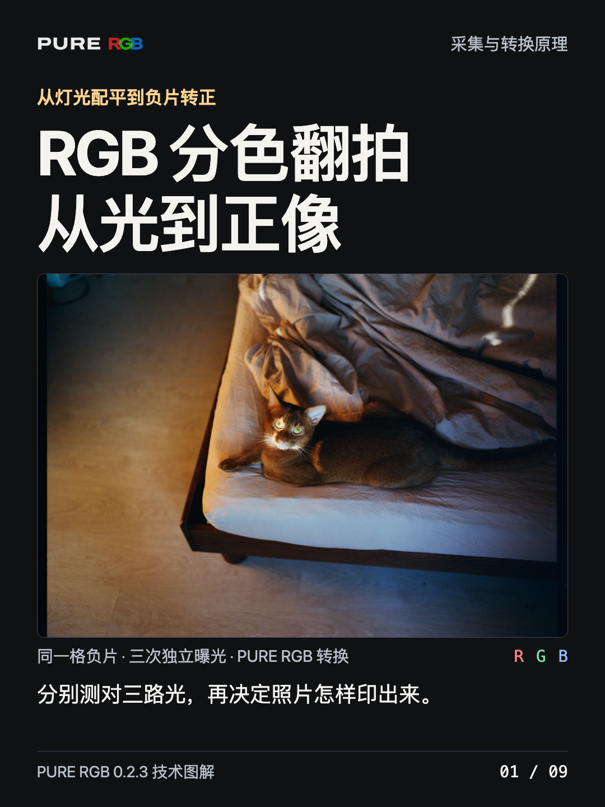
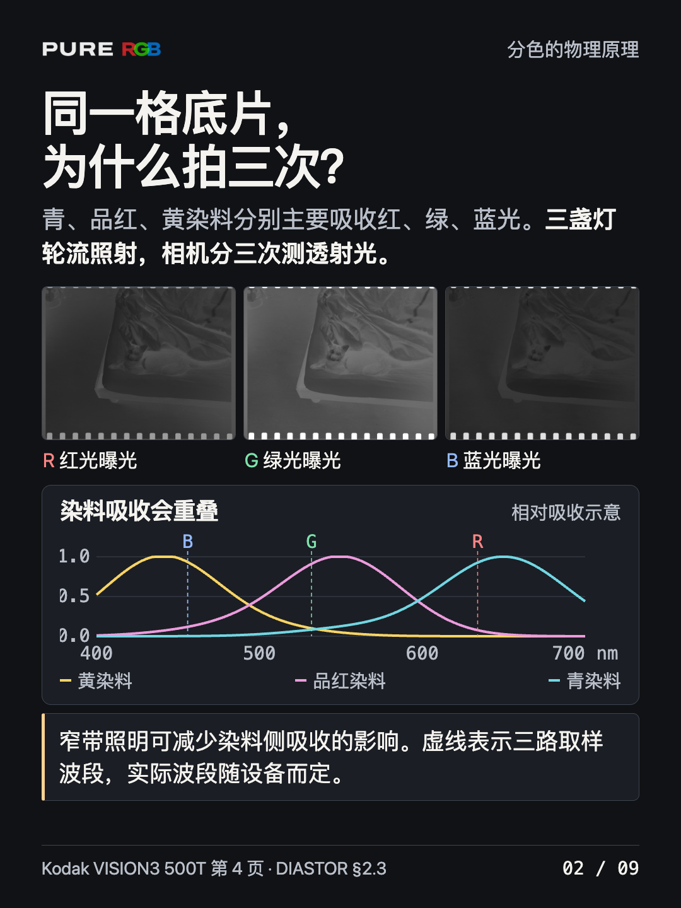
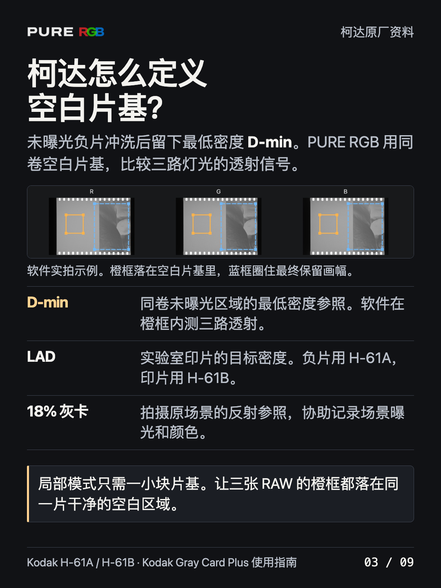
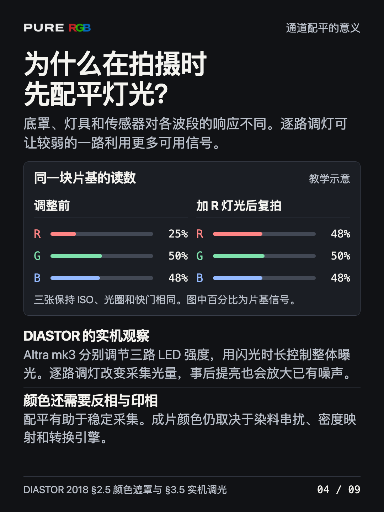
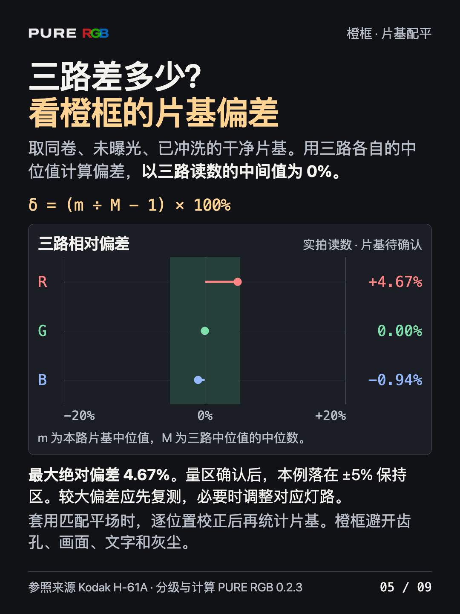
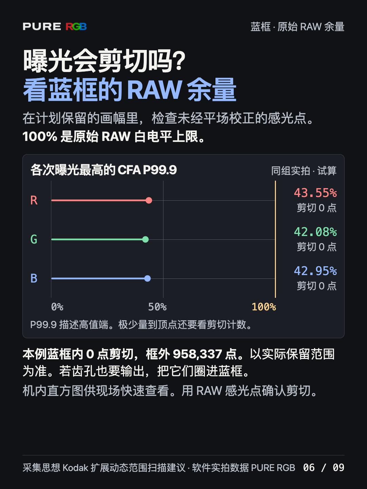
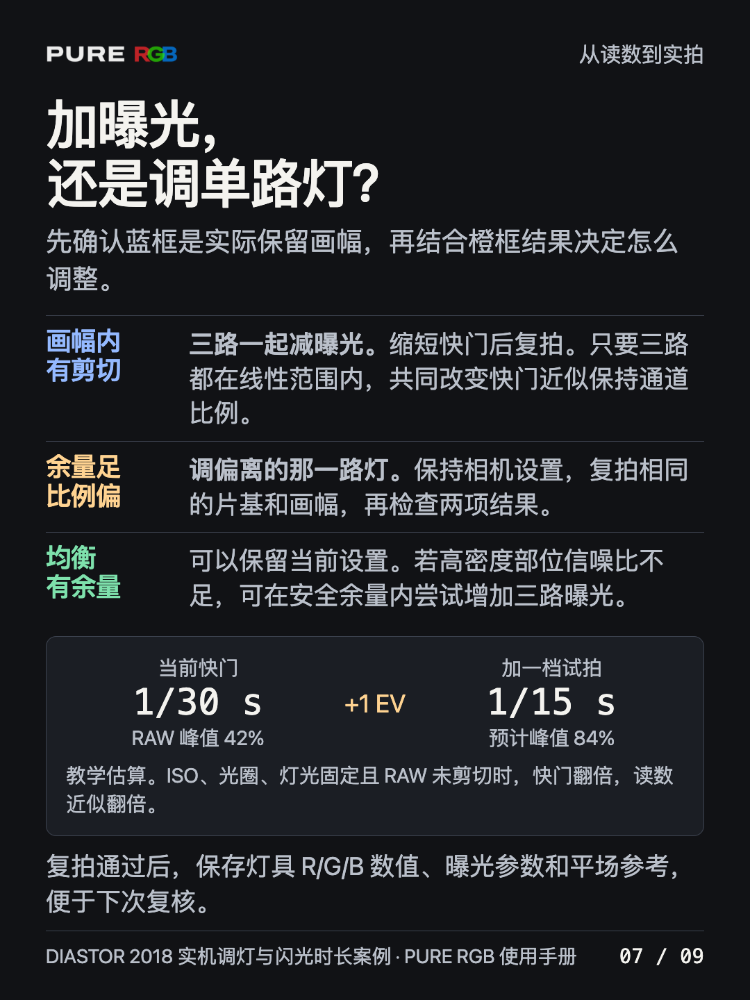
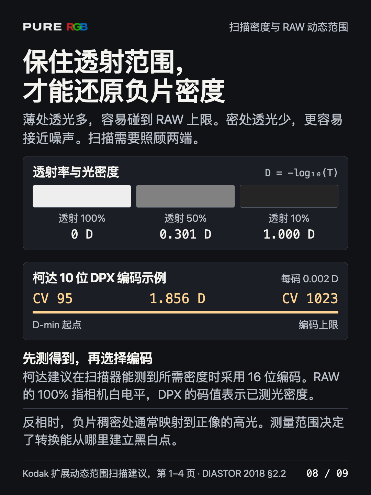
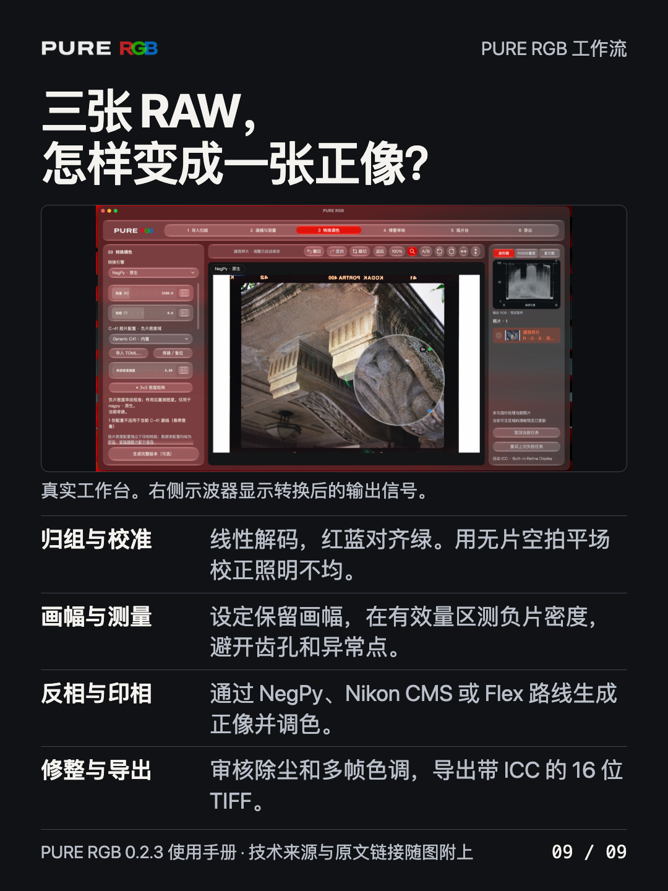

# RGB 分色翻拍 · 从灯光配平到负片转正

[English](RGB_TRICHROME_GUIDE.en.md) · [PURE RGB 使用手册](OPERATING_MANUAL.zh-CN.md) · [配平操作与中英文参考](RGB_LIGHT_BALANCE_BILINGUAL.md)

同一格负片用红、绿、蓝光各拍一张 RAW，三张照片分别记录不同波段的透射光。翻拍时可以逐路调整灯光，让较弱的通道利用更多可用信号，再用实际保留画幅检查三路是否还有 RAW 曝光余量。PURE RGB 0.2.3 将这两项检查做成可选工具，读数用于指导复拍。

## 同一格底片，为什么拍三次？

冲洗后的彩色负片主要由青、品红、黄三种染料形成影像。青染料主要吸收红光，品红主要吸收绿光，黄主要吸收蓝光。三种染料的吸收带会重叠。选用合适的窄带光，可以减小部分侧吸收的影响。相机在三次曝光中分别测量光通过底片后的信号。实际响应还取决于底片、灯光光谱和感光点的灵敏度。下图的曲线用于说明波段重叠，虚线标出示意取样位置。 [柯达 VISION3 500T 5219 技术资料，第 4 页](https://www.kodak.com/content/pdfs/motion/KODAK-VISION3-500T-5219-7219-technical-information.pdf#page=4) · [DIASTOR 胶片与扫描仪研究，第 2.3 节](https://scan2screen.com/wp-content/uploads/2026/06/flueckigeretal_investigationfilmmaterialscannerinteraction_2018_v_1-1c.pdf#page=15)

## 柯达资料中的三个参照

- **D-min** 是冲洗后未曝光负片的最低密度参照。PURE RGB 选取同卷、已冲洗的空白片基，在同一块区域比较红、绿、蓝三次照明的透射信号。只需要三张 RAW 都覆盖的一小块干净片基。 [柯达 H‑61A](https://www.kodak.com/content/products-brochures/Film/LAD-for-KODAK-Color-Negative-Film-H-61a.pdf)
- **LAD** 是实验室调校印片流程的目标密度。H‑61A 说明彩色负片标准片，H‑61B 说明指定彩色印片材料的目标。 [柯达 H‑61A](https://www.kodak.com/content/products-brochures/Film/LAD-for-KODAK-Color-Negative-Film-H-61a.pdf) · [柯达 H‑61B](https://www.kodak.com/content/products-brochures/Film/LAD-for-KODAK-VISION-Color-Print-Film-H-61b.pdf)
- **18% 灰卡** 是原始拍摄场景的反射参照，用于记录曝光与颜色。 [Kodak Gray Card Plus 使用指南](https://www.kodak.com/en/motion/page/gray-card/)

## 为什么要在采集时配平？

片基底罩对三个波段的吸收不同，灯具和感光点的响应也有差别。分别调灯能帮助较弱一路利用更多可用信号。DIASTOR 的研究说明，可独立调整波段强度的扫描光源能更充分地利用各波段的传感器范围。研究中的 Altra mk3 能分别调三路 LED，用闪光时长调整体曝光。在固定 ISO、光圈和快门的教学例中，片基读数从 **25%、50%、48%** 变成 **48%、50%、48%**，这里改变的是红灯有效光量。最后的色彩还取决于负片密度、染料串扰和转换配方。 [DIASTOR 第 2.5 节](https://scan2screen.com/wp-content/uploads/2026/06/flueckigeretal_investigationfilmmaterialscannerinteraction_2018_v_1-1c.pdf#page=17) · [Altra mk3 实机观察](https://scan2screen.com/wp-content/uploads/2026/06/flueckigeretal_investigationfilmmaterialscannerinteraction_2018_v_1-1c.pdf#page=42)

两只测量框可以分别移动和确认。一块回答灯光的相对比例，一块回答保留画幅的曝光余量。

| 量区 | 读取什么 | 对应操作 |
| --- | --- | --- |
| 橙框 · 同卷干净片基 | 三路片基中位值的相对偏差。选用匹配的平场时，先校正再统计。 | 判断哪一路灯偏强或偏弱。 |
| 蓝框 · 实际保留画幅 | 校正前的原始 RAW 感光点。100% 是白电平上限。 | 判断是否需要共同调整三路曝光。 |

### 橙框测片基，决定调哪一路灯

用相同 ISO、光圈和快门，在三路灯光下各拍一张带同一片基的 RAW。将橙框完全放进三张都覆盖的干净空白片基内，避开齿孔、画面、片边字样和灰尘。橙框的位置可以在蓝框内或外。用各路片基的中位值 m 与三路中位值的中间值 M 比较。**相对偏差 = (m ÷ M − 1) × 100%。**

图中实拍试算为 **R +4.67%、G 0.00%、B −0.94%**，最大绝对偏差 **4.67%**。示例片基量区仍待确认。核对后如果读数有效，这组数字落在 PURE RGB 的 **±5% 保持区**。超过 5% 且不超过 10% 建议复测，超过 10% 进入调整判断。软件给出的百分比描述预计有效光量变化，实际灯具刻度要通过复拍核对。 [配平操作与计算规则](RGB_LIGHT_BALANCE_BILINGUAL.md)

### 蓝框查 RAW 余量，决定要不要一起改快门

圈住最终要保留的照片，按需要纳入齿孔，再确认画幅。右侧按滤色阵列（CFA）的感光点类别计算 P99.9，每次曝光显示其中最高的分位读数，并单独统计到达白电平的感光点。**100% 是白电平上限。** 少数到顶点可能出现在 P99.9 尚未到顶的读数中，需要同时查看计数。

同一组实拍试算中，蓝框内的最高 CFA P99.9 分别为 **43.55%、42.08%、42.95%**，三路合计 **框内 0 点剪切、框外 958,337 点剪切**。图中画幅仍待确认。这两个计数只对应试算的范围，按实际要导出的画幅确认后，再根据原始 RAW 作判断。配平工具中，所选平场作用于橙框的相对读数，蓝框的余量从校正前的 RAW 读取。 [PURE RGB 配平说明](RGB_LIGHT_BALANCE_BILINGUAL.md) · [柯达扩展动态范围扫描建议](https://www.kodak.com/content/products-brochures/Film/Scanning-Recommendations-for-Extended-Dynamic-Range-Camera-Films-EN.pdf#page=3)

## 读完结果，怎么调灯和快门？

1. **保留画幅有剪切风险**。保持灯光、ISO 和光圈，先缩短三路快门再复拍。在三路均处于线性、未剪切范围时，共同改变快门会近似维持灯光比例。
2. **保留画幅有余量，片基偏差较大**。保持相机参数，调整相应灯路，再拍三张校验。若调整灯路后重新接近白电平，再处理整体曝光。
3. **片基配平且画幅有余量**。可以维持当前设置。若高密度细节信号偏弱，可按安全余量选择试拍。在教学例中，峰值 42% 时将三路从 1/30 秒改为 1/15 秒，预计约 84%，需以复拍实测确认。

复拍确认结果后，可以把灯具 R/G/B 原始刻度记录为参考。复用时对照同一灯具同一刻度，并核对曝光参数和平场。 [PURE RGB 配平操作](OPERATING_MANUAL.zh-CN.md) · [Altra mk3 实机观察](https://scan2screen.com/wp-content/uploads/2026/06/flueckigeretal_investigationfilmmaterialscannerinteraction_2018_v_1-1c.pdf#page=42)

## 从 RAW 透射到负片密度

负片薄处透光多，可能碰到相机白电平。负片密处透光少，信号容易接近噪声。以透射比 T 表示通过的光比例，**光密度 D = −log₁₀(T)**。透过 50% 的光约为 0.301 D，透过 10% 为 1.000 D。负片转正时，密处通常映射到正像高光。 [DIASTOR 第 2.1–2.2 节](https://scan2screen.com/wp-content/uploads/2026/06/flueckigeretal_investigationfilmmaterialscannerinteraction_2018_v_1-1c.pdf#page=11)

柯达展示了传统 10 位 DPX 的扫描编码方案。D-min 放在码值 95，每码表示 0.002 D。到码值上限 1023，可编码 **1.856 D** 的相对密度范围。在扫描器能测得所需胶片密度范围的前提下，柯达优先推荐 16 位编码来保存这些信号。这是扫描文件的密度编码。三色翻拍的 RAW 余量则由采集端白电平决定，应用输出的 16 位 TIFF 保存后续转换的 RGB 级差。 [柯达扩展动态范围扫描建议，第 1–4 页](https://www.kodak.com/content/products-brochures/Film/Scanning-Recommendations-for-Extended-Dynamic-Range-Camera-Films-EN.pdf)

## 三张 RAW 怎样变成一张正像？

PURE RGB 从固定尺度的线性数据提取 R、G、B，配准后合成，并按选用的平场校正照明不均。设定输出画幅与有效测量区后，以 NegPy 原生或实验分区方式测量负片范围，再走 NegPy、Nikon CMS 或 FlexColor 路线转换。工作台示波器读取高光、暗部及通道的输出 RGB 信号，显示器 ICC 随后参与屏幕显示。最后可审核除尘和整卷色调，导出带 ICC 的 16 位 TIFF。 [PURE RGB 中文使用手册](OPERATING_MANUAL.zh-CN.md) · [0.2.3 发布说明](releases/0.2.3.md)

